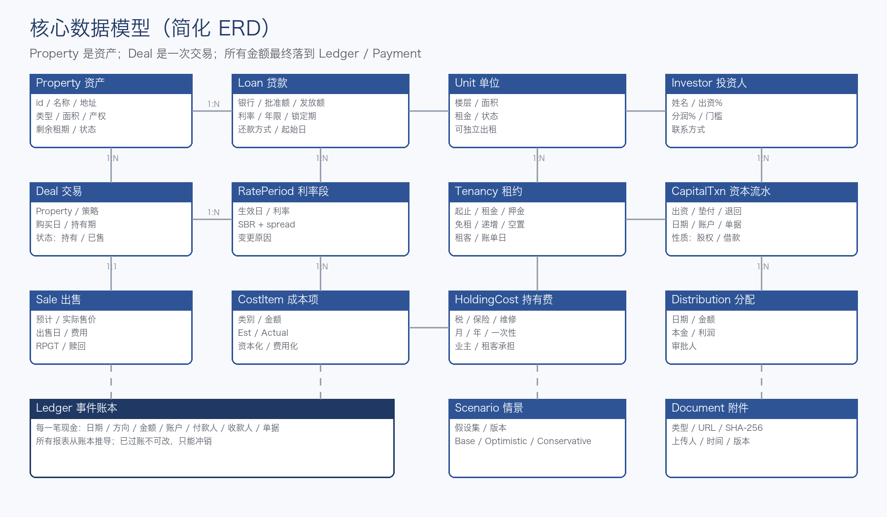
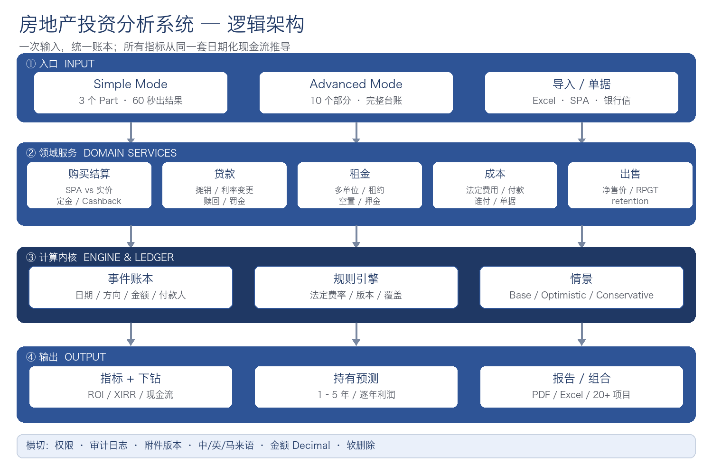

# 房地产投资分析系统

### 买入成本清单 + 卖出利润：个人买 → 持有 1–5 年 → 卖出的快速计算程序

| 项目 | 内容 |
| :--- | :--- |
| 版本 | v1.1 定稿（待确认） |
| 日期 | 2026-10-19 |
| 对象 | Andy Lau / EAG |
| 依据 | Excel 4 个案例  ·  SPA / Loan Quotation  ·  2 张界面截图  ·  10/19 确认意见 |
| 状态 | 确认后进入 Phase 0 开发 |

# 00 目录与阅读路线

*这份文件怎么读：先看结论，再看证据，最后看方案。*

如果你只有 10 分钟，读第 0 章和第 2.6 节；如果你要给程序师报价，读第 6–13 章；如果你要确认我有没有理解错你的生意，读第 2–4 章。

| 章 | 标题 | 这一章回答什么 |
| :---: | :--- | :--- |
| 00 | 目录与阅读路线 | 这份文件的结构、结论与待定事项 |
| 01 | 分析范围与方法 | 我看了什么、怎么验证、哪些还不能下结论 |
| 02 | Excel 逆向分析：4 个案例到底怎么算 | 逐行拆解 Austin Perdana、L.T、Cashback、Downpay；找出 8 个结构性问题 |
| 03 | 两份报价单：哪些费用可以自动算 | S&P / Loan 律师费、印花税、SST、disbursement 的公式与对账 |
| 04 | 需求逐项评审（Part 1–10） | 你列的 10 个部分，哪些够、哪些缺、每个字段该怎么设计 |
| 05 | 输出指标：定义、公式与常见错误 | ROI、Cash-on-Cash、Annualized、XIRR、Yield、Break-even 到底怎么算 |
| 06 | 系统设计原则 | 三张报表、事件账本、日期驱动、可解释、可审计 |
| 07 | 数据模型 | 18 个核心实体、字段、关系与 ERD |
| 08 | 计算引擎规格 | 从结算单到持有 1–5 年投影的 10 步计算顺序与伪代码 |
| 09 | 持有 1–5 年预测 | 等额本息月供、逐年贷款余额、租金累计、RPGT 按年分档、逐年净利润 |
| 10 | 情景、反向计算与持有能力 | Base/Optimistic/Conservative、最高买价、现金储备压力测试 |
| 11 | 界面与第一页 | Simple / Advanced 两种模式；3 个 Part 的第一页（买入一次性/年度费用/年度利润）；每个数字可下钻 |
| 12 | 技术架构与选型 | Web 应用、PostgreSQL、计算引擎、附件、权限、部署 |
| 13 | 路线图、工作量与验收 | 5 个阶段、约 55–65 人周、4 个案例 + 12 个边界（21 项测试） |
| 14 | 风险与合规 | SPA 价差、Cashback、RPGT、SST、PDPA 的红线 |
| 15 | 待确认问题 | 12 个需要你拍板的问题，附推荐默认值 |
| A | 附录 A：字段总表 | 约 120 个字段的类型、单位、必填、所属模式 |
| B | 附录 B：公式速查 | 一页纸的公式清单，可直接贴给程序师 |
| C | 附录 C：术语表 | SPA、LA、MOT、RPGT、Redemption、Retention 等 |
| D | 附录 D：4 个案例原始数据 | 从 Excel 抄出的输入与输出，便于回归测试 |

# 0 执行摘要：先看这 3 页

*这一章是给“没时间读完整份”的你，也是给程序师的第一张地图。*

## 0.1 一句话结论

> [!NOTE]
> **结论**
>
> 你要的是一个“两用”的快速计算程序：买入时给买家一张成本清单，卖出时按个人口径算出净利润，中间支持 1–5 年持有预测（租金累计 + 贷款余额递减）。v1 不做投资人分账、不做电子签、不做 App；核心是快——最少输入、最快出利润。

我把你给的 4 个 Excel 案例逐行拆开，把两份报价单的费率表反算成公式，再对照截图里的 23 个第一页字段（现已按你的 3 个 Part 重排）。好消息是：你的业务逻辑已经跑通，4 个案例覆盖了正常贷款、超额融资、多人合资、长期持有四种典型结构；坏消息是：这 4 个模板对“定金、首期、Cashback、本金、赎回、税费”的处理并不统一，直接照搬会把误差放大到 2–3 倍（见 0.2 的对账）。

## 0.2 四个案例：Excel 的结果 vs 复核后的结果

下表全部用你 Excel 里的原始数字重算；复核口径在 2.6 节逐条解释。Case A 因为缺少完整的 completion statement，只能做“部分复核”。

| 案例 | 持有月 | Excel ROI | Excel 年化 | 复核 ROI | 复核年化 | 关键差异 |
| :--- | :---: | ---: | ---: | ---: | ---: | :--- |
| A  Austin Perdana | 17 | 156.3% | 110.3% | 158.7%\* | 112.0%\* | SPA 1.60M vs 实价 1.25M；赎回 1.296M > 贷款 1.28M；缺结算单 |
| B  Profit Calculator (L.T) | 25–27 | 9.11% | 4.37% | 4.56% | 2.03% | 出售税 3,545 未进利润；本金 28,349 与赎回余额 696,562 对不上 |
| C  Loan Cashback | 13 | 114.5% | 105.7% | 176.2% | 162.6% | 定金 14,700 被重复计算；真实初始现金 19,270，不是 33,970 |
| D  Loan Downpay | 23 | 18.66% | 9.73% | 20.23% | 10.56% | 定金 16,000 被重复计算；现金投入 152,422，不是 168,422 |

*ROI 均为“利润 ÷ 现金投入”的 Cash-on-Cash 口径；\* Case A 为部分复核，未解决 SPA/实价差额与赎回金额异常。完整计算见《公式验证与案例对账》工作簿。*

这张表最重要的不是“谁对谁错”，而是：同一笔交易，只换一个口径，ROI 可以从 4.56% 变成 9.11%，也可以从 114% 变成 176%。如果系统不把口径写死、不把每一笔现金流对平，你给买家看的数字就不可信。

## 0.3 Excel 里最值得警惕的 5 个结构性问题

**① 定金 / 首期 / Cashback 三套算法。**Case B 正确扣了定金（64,000 = 800k − 720k − 16k）；Case C 没扣（−30,000 = 735k − 765k）；Case D 没扣还再加一次定金（80,000 + 16,000）。同一个“首期”，三种结果。

**② 本金、利息、赎回余额是三套数。**Case B 用 28,349 作为已还本金，但赎回余额 696,562 反推只有 23,438；Case D 也有 180 的差额。利润表与现金流表因此永远对不上。

**③ 费用漏项或错分类。**Case B 的 3,545.45 出售税没有进 gross profit；Case A 把 30,000 RPGT 放进购买成本，又把 48,600 retention 排除在利润外。两者都不是“错”，但没有统一规则。

**④ 分母混用，杠杆被隐藏。**4 个案例的 ROI 分母都是“现金投入”，不是“总成本”。Case A 的现金 ROI 156%，总成本 ROI 只有 13.6%；Case C 的现金 ROI 176%，总成本 ROI 只有 6.1%。

**⑤ 分账与出资脱钩（已决定 v1 不做分账）。**Austin Perdana 里 Nico 的现金出资是 0，却分 50% 利润；Andy 垫付了几乎全部现金。这暴露了多人合资必须有资本账户。但按 10/19 的确认，v1 只做“个人买入 → 持有 → 卖出”，投资人分账整体移出；将来要做时再按资本账户模型加回来。

## 0.4 两份报价单告诉我们的：法定费用可以自动算，但“总额”不能硬抄

报价单的 Scale Fee 和 Stamp duty 两列，与法定公式 100% 吻合：S&P 律师费 1.25% 首 50 万、之后 1%；S&P 印花税 1%/2%/3%/4% 四档；贷款律师费同一费率表；贷款印花税 0.5%。

但报价单的 “Total for 1 Purchaser” 并不是“律师费 + 印花税”：它还包含 8% SST、贷款 stamping、以及 RM3,000–5,000 的 disbursement。以 RM1,600,000 为例，法定两项合计 65,250，报价总额 77,487，差额 12,237 没有任何明细。所以系统必须把它拆成“法定费用（自动算）+ 律所杂费（可覆盖）+ 差异提示”，而不是把 77,487 当成一个黑盒。

## 0.5 建议建什么：三层，而不是一个大表单

**1. 第一层：计算引擎：**纯函数、可测试、版本化。输入价格、贷款、租金、持有年限、卖价，输出摊销表、现金流、RPGT、逐年净利润、ROI/XIRR。先做成 Excel/CLI 验证，再嵌入 Web。

**2. 第二层：交易工作台：**每个项目一个 Deal：购买结算、贷款、装修、出租、持有、出售。所有金额落到带日期的 Ledger；每个 KPI 可下钻。

**3. 第三层：组合与团队：**20+ 项目的组合看板、报告、权限；再往外才是 SaaS 计费（RM50/年）与多租户。

## 0.6 怎么建：5 个阶段，约 55–65 人周

| 阶段 | 工期 | 范围 | 验收 |
| :--- | :---: | :--- | :--- |
| Phase 0 | 2 周 | 公式引擎 + 等额本息 + 1–5 年投影 + 4 案例回归 + 法定费用计算器 | 可运行的 engine + 测试 + Excel 验证 |
| Phase 1 | 8 周 | Simple Mode、项目/交易、贷款、租金、持有年限、出售、8 个 KPI、PDF | 4 个案例可在系统里复现；你自己先用 |
| Phase 2 | 8 周 | 完整台账、成本/付款、1–5 年逐年预测、情景、Excel 导入 | 现金流对平；团队内测 |
| Phase 3 | 6 周 | 组合看板、报告模板、角色权限、银行 CSV | 20+ 项目可用；无 bug 后推广 |
| Phase 4 | 10 周 | SaaS 计费（RM50/年）、onboarding、模板市场、API | 可对外收费用 |

*按 2 名全栈 + 1 名设计/QA 估算；如果只做自用，Phase 3/4 可以延后。*

## 0.7 需要你先拍板的 6 件事

**• 使用对象：**已确认：先自己用 → 团队内测 → 无 bug 再推广 SaaS（RM50/年）。第一版不做多租户，先单实例部署到你的深圳服务器。

**• 平台：**已确认：响应式 Web（手机可用）先做；App 最后才打包上架，前面不碰。

**• 账本深度：**已确认：快速计算优先；轻账本（日期、方向、付款人、收款人、单据），不做复式会计总账。

**• 贷款利息模式：**已确认：默认等额本息（和中国银行一样）；daily rest 作后续可选。

**• RPGT 范围：**只做“估算 + retention 跟踪”，最终税额由律师/税务确认；持有 1–5 年按 30%/20%/15% 分档。

**• 律师费买家人数：**已确认：v1 只按单一买家预测（SPA 与 Loan Agreement 分开）；两人买家后续版本再加。

# 01 分析范围与方法

*我先说明自己看了什么、怎么验证，以及哪些结论还不能下得太满。*

## 1.1 材料清单

| 类型 | 文件 | 我从中读到什么 |
| :--- | :--- | :--- |
| Excel | Andy Lau - Invest Formula (Long Term) Year2026 (4).xlsx | 4 个 sheet：Austin Perdana、Profit Calculator (L.T)、Final Formula w Loan Cashback、Final Formula w Loan Downpay；含公式、数值、批注与格式。 |
| PDF 1 | SPA Quotation_20260526.pdf | 21 页中的 7 页：S&P 律师费费率、S&P 印花税四档、RM50k–RM2.0M 的逐万报价表、1/2 位买主总额。 |
| PDF 2 | Loan Quotation_20260526.pdf | 14 页中的 7 页：贷款律师费费率、贷款印花税 0.5%、RM50k–RM305k 的报价表、1/2 位借贷人总额。 |
| 截图 1 | Investment Analysis 示范版 | Simple Mode 的 10 个输入与 6 个输出卡片；用于反推“第一页”应该放什么。 |
| 截图 2 | 选择你希望在第一页直接输入的资料 | 5 组共 23 个预选字段；用于设计字段分组与默认模板。 |

*Excel 与 PDF 均已复制到工作目录；原始文件未被修改。*

## 1.2 方法：不是“看一眼”，而是逐行对账

**1. 拆公式：**用 openpyxl 以 data_only=False 读取每个单元格的公式，再以 data_only=True 读取缓存值；把 4 个 sheet 的公式链完整还原。

**2. 拆 PDF：**自己写了一个 PDF 文本提取器（处理 Identity-H + ToUnicode），把报价表的 7 页逐行提取；再用 PDFKit 渲染成图片，逐页核对表头与数字。

**3. 反算费率：**用报价表的 Scale Fee / Stamp duty 两列，反推出法定费率表；再用同一套公式回算 8 个价格点，确认 100% 吻合。

**4. 重算案例：**用 Python 重写 4 个案例的现金流，按“结算单 → 摊销 → 租金 → 出售”的顺序逐项对账；差异超过 RM1 的，逐条找原因。

**5. 交叉验证：**用安装额反推贷款利率（Case B/D 约 5.30%，Case C 4.50%），再用银行余额反推已还本金，检查 Excel 的本金/利息是否自洽。

## 1.3 边界与置信度

| 对象 | 置信度 | 原因 / 还缺什么 |
| :--- | :---: | :--- |
| 法定费率 | 高 | 报价单两列与公式完全吻合；但 SST、disbursement、rounding 未在报价单中列明，需律师确认。 |
| 案例 B/C/D 的现金流 | 中高 | 输入完整、公式可还原；但缺少银行对账单、SPA、结算单，本金/赎回余额只能反推。 |
| 案例 A 的完整结算 | 低 | SPA 1.60M vs 实价 1.25M、赎回 1.296M > 贷款 1.28M、H&L refund −58,182.42，均缺少原始单据；只能做部分复核。 |
| RPGT 税额 | 中 | Excel 只给了 retention（3%）和一笔 30,000 的“RPGT”；没有应税增益、豁免、持有期的计算过程。 |
| 1–5 年持有预测 | 中高 | 4 个案例持有 13–27 个月，租金与贷款余额递减逻辑可复用；但缺 5 年长持有的银行对账单做校准，只能用等额本息公式预测。 |

> [!WARNING]
> **这份文件不是法律或税务意见**
>
> 所有费率、RPGT 税率、SST 处理都以“可配置规则 + 实际单据覆盖”的方式实现；最终数额应由律师、税务师或银行确认。系统的作用是把你已经知道的事实算清楚、把不知道的标出来，而不是替代专业人士。

# 02 Excel 逆向分析：4 个案例到底怎么算

*这一章把 4 个 sheet 拆到“每一个数字从哪里来”，并指出哪些地方不能直接照搬。*

4 个案例其实覆盖了 4 种典型结构：A 是“SPA 高于实价 + 贷款覆盖成本 + 多人合资 + 短期转售”；B 是“正常首付 + 长期持有 + 出售税”；C 是“贷款高于实价 + Cashback”；D 是“正常首付 + 装修 + 多单位出租”。把这 4 种结构抽象成 4 个模板，比做 4 个孤立的 calculator 更有价值。

| 案例 | 物业 | 价格结构 | 贷款 | 持有月 | 出售价 | 这个案例教什么 |
| :--- | :--- | :--- | ---: | :---: | ---: | :--- |
| A  Austin Perdana | 3 层店屋 | SPA 1.60M / 实价 1.25M | 1.28M | 17 | 1.62M | 多人合资、贷款覆盖成本、RPGT retention |
| B  Profit Calculator (L.T) | 双层店屋 | SPA 900k / 实价 800k | 720k | 25–27 | 910k | 正常首付、长期持有、出售税 |
| C  Loan Cashback | — | SPA 900k / 实价 735k | 765k | 13 | 850k | 贷款 > 实价、Cashback |
| D  Loan Downpay | 店屋 40 号 | SPA 900k / 实价 800k | 720k | 23 | 910k | 装修、多单位出租、正常首付 |

*价格单位：RM。持有月按 Excel 的租金/供款月份估算；Case B 的 25 个月与 27 个月差异见 2.2。*

## 2.1 Case A：Austin Perdana（多人合资 + SPA 高于实价）

这是 4 个案例里最复杂、也最值得做成“完整 Deal”的一个：它同时有 SPA 价差、贷款覆盖律师费、RPGT、租客押金、预收租金、两位投资人。

| 项目 | 数值（RM） | 说明 |
| :--- | ---: | :--- |
| 买入价 Buy-in | 1,250,000 | 实际付给卖方的价格；与 SPA 1,600,000 相差 350,000 |
| SPA 价 | 1,600,000 | 银行按此计算 80% 贷款 = 1,280,000 |
| 贷款 | 1,280,000 | 另有 MRTA 8,000，合计 1,288,000 |
| 定金 | 100,000 | Andy 付给 H&L |
| SPA 律师费 | 72,834 | 含律师费、印花税、disbursement 的混合数 |
| 贷款律师费 | 25,483.58 | 含贷款律师费、印花税、disbursement 的混合数 |
| RPGT | 30,000 | 被放在购买成本里；性质待确认 |
| 估值费 | 3,250 |  |
| 买方 agent 1% | 13,250 | 1,250,000 × 1% |
| 其他 | 78 | Cukai tanah |
| MRTA | 8,000 | 贷款保险 |
| Total Invest Amount | 1,402,895.58 | 买入价 + 以上全部费用 |
| 实际现金投入 | 119,895.58 | 定金 + 部分费用 − H&L refund + 供款垫付 |
| 租金净流入 | 14,850 | 22-02 单位 1,650 × 9 个月；22/22-01 的 10 个月填 0 |
| 出售价 | 1,620,000 |  |
| 赎回金额 | 1,296,950 | 比贷款 1,288,000 还高 8,950 |
| 出售费用 | 41,669.21 | agent 2%+8% SST 34,992 + 律师 5,000 + 其他 1,677.21 |
| RPGT retention | 48,600 | 售价 3%；不是最终税额 |
| 退还租客押金 | 12,300 |  |
| 退还预收租金 | 2,865.87 |  |
| 出售现金回报 | 217,614.92 | 售价 − 赎回 − 出售费用 − retention − 押金 − 预收租金 |
| Excel 净利润 | 187,419.34 | gross profit 172,569.34 + 租金 14,850 |
| Excel ROI / 年化 | 156.3% / 110.3% | 分母是 119,895.58；持有 17 个月 |

*数据来自 Excel 的 C/D/H 列与批注；最后三行是 Excel 的输出。*

### Excel 的计算链

```text
Total Invest Amount = 1,250,000 + 72,834 + 25,483.58 + 30,000 + 3,250 + 13,250 + 78 + 8,000
                   = 1,402,895.58

Actual Cash Out     = 100,000 + 13,250 + 26,500 + 30,000 + 3,250 + 78 − 58,182.42 + 5,000
                   = 119,895.58

Gross Profit        = 1,620,000 − 1,402,895.58 − 34,992 − 5,000 − 1,677.21 − 2,865.87
                   = 172,569.34

Net Return          = 172,569.34 + 14,850 = 187,419.34
ROI                 = 187,419.34 / 119,895.58 = 156.3%
Annualized          = 156.3% / 17 × 12 = 110.3%
```

### 我看到的 5 个问题

- **SPA 与实价的 350,000 没有“落脚点”。**Excel 把 1,250,000 当买入价，把 1,600,000 当 SPA；贷款按 SPA 的 80% 发放 1,280,000。差额 350,000 既没有作为卖方回扣、也没有作为现金回流、更没有作为结算单的一行。它可能被 H&L refund −58,182.42 部分吸收，但金额对不上。没有 completion statement，就无法判断这 350,000 是“真实折价”“卖方承担的费用”还是“文件价格”。
- **赎回 1,296,950 > 贷款 1,288,000。**正常摊销 17 个月后余额应低于本金；这里反而高 8,950，说明可能含罚息、逾期利息、提前赎回罚金，或贷款金额记忆有误。系统必须以银行 settlement letter 为准，不能从月供反推。
- **RPGT 的“30,000 成本”与“48,600 retention”是两件事。**30,000 被计入购买成本，影响 gross profit；48,600 是买方律师扣下、交给 LHDN 的暂扣款，未来可退。两者不能混。正确做法是：RPGT payable 进利润，retention 进现金流的“暂扣”科目，退款另记。
- **押金与预收租金的处理不一致。**出售时退押金 12,300 被排除在 gross profit 之外（这是对的，押金是负债），但预收租金 2,865.87 被扣进 gross profit（这不对，预收租金也是负债）。同样的性质，两种处理。
- **50/50 分账与出资无关（v1 已决定不做分账）。**Nico 的现金出资是 0，但分 50% 利润；Andy 垫付了几乎全部现金。这是协议分润，不是出资比例。它说明多人合资必须有资本账户——但按 10/19 的确认，v1 把整间房当作个人买卖处理，投资人分账移出范围，将来要做再按资本账户模型加回来。

> [!WARNING]
> **Case A 的复核结论**
>
> 在不改变 Excel 数字的前提下，若把预收租金从利润中拿掉（它是负债），净利润应为 190,285.21，现金 ROI 158.7%，年化 112.0%。但 SPA/实价差额与赎回异常仍未解决，所以这只是“部分复核”，不能当作最终答案。

## 2.2 Case B：Profit Calculator (L.T)（正常首付 + 长期持有）

这个案例的结构最“正常”：实价 800,000、SPA 900,000、贷款 720,000、定金 16,000、持有约 25 个月、出售 910,000。它的价值在于展示“租金 − 供款”的持有现金流，以及出售时的税费。

| 项目 | 数值（RM） | 说明 |
| :--- | ---: | :--- |
| 买入价 | 800,000 | 实际成交价 |
| SPA 价 | 900,000 | 贷款按 SPA 的 80% = 720,000 |
| 贷款 | 720,000 | 占实价 90% |
| 定金 | 16,000 | 2% |
| 购买成本 | 72,422.24 | SPA 律师 10,735.68 + LA 27,446.56 + agent 19,240 + 装修 15,000 |
| Total Invest | 872,422.24 | 800,000 + 72,422.24 |
| 初始现金 | 152,422.24 | 定金 16,000 + 成本 72,422.24 + 尾款 64,000 |
| 租金 | 72,200 | 48,000 + 4,400 + 19,800 |
| 供款 | 100,000 | 4,000 × 25 |
| 已还本金 | 28,349 | Excel 手填 |
| 出售价 | 910,000 |  |
| 赎回余额 | 696,562.27 | Excel 手填；反推已还本金约 23,438 |
| 出售费用 | 25,199.45 | 律师 1,998 + 税 3,545.45 + agent 19,656 |
| Gross Profit | 15,923.76 | 910,000 − 872,422.24 − 1,998 − 19,656（漏了 3,545.45） |
| Net Return | 16,472.76 | Gross + 549（租金 − 供款 + 本金） |
| Excel ROI / 年化 | 9.11% / 4.37% | 分母 180,771.24 = 152,422.24 + 28,349 |

```text
Gross Profit (Excel) = 910,000 − 872,422.24 − 1,998 − 19,656
                     = 15,923.76          ← 没有减 3,545.45 的税

Rental P/L          = 72,200 − 100,000 = −27,800
"Interest"          = −27,800 + 28,349 = 549
Net Return          = 15,923.76 + 549 = 16,472.76
ROI                 = 16,472.76 / (152,422.24 + 28,349) = 9.11%

按赎回余额反推：
Principal           = 720,000 − 696,562.27 = 23,437.73
Interest            = 100,000 − 23,437.73 = 76,562.27
Net Profit          = 15,923.76 − 3,545.45 − (28,349 − 23,437.73)
                    = 8,016.04
ROI                 = 8,016.04 / (152,422.24 + 23,437.73) = 4.56%
```

### 这个案例暴露的 3 个问题

- **税被漏在利润之外。**C41 的 3,545.45（Cukai Tanah & Harta）只进了 Actual Cash Return，没有进 Gross Profit。利润因此高估 3,545.45（约 22% 的净利润）。
- **本金与赎回余额对不上。**Excel 用 28,349 作为已还本金，但赎回余额 696,562.27 反推只有 23,437.73；两者差 4,911.27。利润、现金回报、ROI 三张表因此无法对平。
- **25 个月与 27 个月混用。**供款写 25 个月（Feb23–Feb25），出售写 Jun25；按 27 个月年化，ROI 会从 4.37% 降到约 4.05%。持有期的起止必须统一到日期，而不是“月数”手填。

> [!CAUTION]
> **Case B 的复核结论**
>
> 把税补进去、用赎回余额统一本金后，真实净利润是 8,016.04，ROI 4.56%，年化 2.03%——大约是 Excel 结果的一半。这不是小误差，而是“费用漏项 + 本金不一致”叠加的结果。

## 2.3 Case C：Loan Cashback（贷款高于实价）

这是最容易被误读的案例：贷款 765,000 > 实价 735,000，交割时买方拿到现金回流；Excel 把这笔钱当成“减少现金投入”，但没有处理好定金。

| 项目 | 数值（RM） | 说明 |
| :--- | ---: | :--- |
| 买入价 | 735,000 | 实际成交价 |
| SPA 价 | 900,000 | 贷款 765,000 = SPA 的 85% |
| 贷款 | 765,000 | 占实价 104% |
| 定金 | 14,700 | 2% |
| 购买成本 | 49,269.92 | SPA 律师 29,722 + LA 9,556.92 + 估值 2,200 + agent 7,791 |
| Total Invest | 784,269.92 | 735,000 + 49,269.92 |
| Excel 现金投入 | 33,969.92 | 14,700 + 49,269.92 − 30,000 |
| 租金 | 24,700 | 1,900 × 13 |
| 供款 | 50,389.82 | 3,876.14 × 13 |
| 已还本金 | 8,000 | Excel 手填 |
| 出售价 | 850,000 |  |
| 赎回余额 | 757,000 |  |
| Gross Profit | 65,730.08 | 850,000 − 784,269.92 |
| Net Return | 48,040.26 | 65,730.08 − 17,689.82 |
| Excel ROI / 年化 | 114.5% / 105.7% | 分母 41,969.92 = 33,969.92 + 8,000 |

### 定金到底有没有被重复计算？

按马来西亚的常规做法，定金（booking fee / earnest deposit）是成交价的一部分，交割时会在尾款里扣回。Case B 就是这么处理的：尾款 = 800,000 − 720,000 − 16,000 = 64,000。但 Case C 的 D16 只写了 735,000 − 765,000 = −30,000，没有把 14,700 的定金从尾款里扣掉，然后 D18 又把 14,700 加进现金投入。结果是：定金被算了两次，现金投入从 19,269.92 被抬高到 33,969.92。

```text
正确的交割现金流（定金已付）：
尾款              = 735,000 − 14,700 = 720,300
贷款              = 765,000
交割现金流入       = 765,000 − 720,300 − 49,269.92 = −4,569.92
加定金             = −14,700
初始现金投入       = 19,269.92

Excel 的口径：
初始现金投入       = 14,700 + 49,269.92 − 30,000 = 33,969.92   ← 多了 14,700

按正确口径：
净利润             = 48,040.26
现金投入（含本金） = 19,269.92 + 8,000 = 27,269.92
ROI                = 176.2%（不是 114.5%）
仅按初始现金       = 249.3%
```

### 这个案例的 3 个提醒

- **Cashback 是融资流入，不是收入。**贷款 765,000 − 实价 735,000 = 30,000 的现金回流，本质是“用房产多借了 30,000”，未来要用更高的赎回额偿还。它降低的是现金投入，不是利润。
- **102% LTV 是高风险结构。**贷款超过实价 4%，一旦房价下跌或银行重估，赎回时可能出现负资产。系统应在 Deal 上打“高杠杆”标签，并做压力测试。
- **没有出售费用，结果偏乐观。**这个案例的出售费用是 0；真实交易至少 2–3% agent + 律师费 + RPGT。加上 3% 出售费用（25,500），净利润会降到约 22,540，ROI 约 82.6%。

> [!CAUTION]
> **Case C 的复核结论**
>
> Excel 的净利润 48,040.26 是对的（它等于“售价 − 实价 − 成本 − 利息 + 租金”），但现金投入 33,969.92 是错的；真实初始现金 19,269.92。同一笔交易，ROI 从 114.5% 变成 176.2%。

## 2.4 Case D：Loan Downpay（正常首付 + 装修 + 多单位）

这个案例的结构与 B 很像，但多了 15,000 装修和三个出租单位；它的问题也最直接：定金被加了两次。

| 项目 | 数值（RM） | 说明 |
| :--- | ---: | :--- |
| 买入价 | 800,000 |  |
| SPA 价 | 900,000 | 贷款 720,000 = SPA 的 80% |
| 贷款 | 720,000 | 占实价 90% |
| 定金 | 16,000 |  |
| 购买成本 | 72,422.24 | SPA 律师 10,735.68 + LA 27,446.56 + agent 19,240 + 装修 15,000 |
| Total Invest | 872,422.24 | 800,000 + 72,422.24 |
| Excel 现金投入 | 168,422.24 | 16,000 + 72,422.24 + 80,000（定金重复） |
| 正确现金投入 | 152,422.24 | 16,000 + 72,422.24 + 64,000 |
| 租金 | 62,900 | 42,000 + 4,400 + 16,500 |
| 供款 | 92,000 | 4,000 × 23 |
| 已还本金 | 28,210 | Excel 手填；赎回余额反推 28,030 |
| 出售价 | 910,000 |  |
| 赎回余额 | 691,970 |  |
| Gross Profit | 37,577.76 | 910,000 − 872,422.24 |
| Net Return | 36,687.76 | 37,577.76 − 890 |
| Excel ROI / 年化 | 18.66% / 9.73% | 分母 196,632.24 |
| 复核 ROI / 年化 | 20.23% / 10.56% | 分母 180,452.24 |

```text
Excel 的尾款：
D17 = 800,000 − 720,000 = 80,000
D19 = 16,000 + 72,422.24 + 80,000 = 168,422.24   ← 定金算了两次

正确的尾款：
尾款 = 800,000 − 720,000 − 16,000 = 64,000
D19 = 16,000 + 72,422.24 + 64,000 = 152,422.24

按正确现金投入：
净利润 = 36,507.76
现金投入（含本金 28,030） = 152,422.24 + 28,030 = 180,452.24
ROI = 20.23%，年化 10.56%
```

### 这个案例的 2 个提醒

- **同一个“定金”，B 扣了、D 没扣。**B 的 D17 是 800,000 − 720,000 − 16,000 = 64,000；D 的 D17 是 800,000 − 720,000 = 80,000。两个模板由不同人/不同时间做，口径没有统一。系统必须在“结算单”层面强制扣定金，不能留给用户自由填。
- **多单位出租是好事，但单位编码要唯一。**D 里“40-01”出现两次（May23–Aug24 与 Oct23–Dec24），实际是两个不同的租约/期间。系统需要“Unit + Tenancy”两层，而不是在一个 free-text 行里写两个期间。

> [!WARNING]
> **Case D 的复核结论**
>
> 定金重复计算让现金投入多算了 16,000，ROI 因此从 20.23% 被压低到 18.66%。修正后净利润 36,507.76，而不是 36,687.76——差额 180 来自本金 28,210 与赎回余额 28,030 的不一致。

## 2.5 横向对比：4 个模板的 8 个不一致

| 口径 | A | B | C | D |
| :--- | :--- | :--- | :--- | :--- |
| 定金在尾款中扣除 | 部分（H&L refund） | 是（−16,000） | 否（只减 30,000） | 否（80,000 + 16,000） |
| Cashback 处理 | 未单列 | 无 | −30,000，但定金重复 | 无 |
| 已还本金来源 | 未单列 | 手填 28,349 | 手填 8,000 | 手填 28,210 |
| 赎回余额来源 | 银行信 1,296,950 | 手填 696,562.27 | 手填 757,000 | 手填 691,970 |
| 出售税费 | agent 2%+8% SST、律师、其他 | 律师、税、agent | 0 | 0 |
| RPGT | 30,000 成本 + 48,600 retention | 无 | 无 | 无 |
| 押金/预收租金 | 押金排除、预收租金扣利润 | 无 | 无 | 无 |
| ROI 分母 | 实际现金投入 | 现金投入 + 本金 | 现金投入 + 本金 | 现金投入 + 本金 |

*同一列是一个模板；同一行是同一个概念。可以看出：B/C/D 的“定金、本金、赎回”三行没有统一规则。*

## 2.6 8 个结构性缺陷：证据、影响、修复

| 缺陷 | 出现 | 证据 | 影响 | 修复 |
| :--- | :---: | :--- | :--- | :--- |
| 1. 定金重复计算 | C、D | C：33,969.92 vs 19,269.92；D：168,422.24 vs 152,422.24 | ROI 被低估（C 114.5%→176.2%；D 18.66%→20.23%） | 结算单模型：尾款 = 价格 − 定金 − 贷款；定金只出现一次 |
| 2. Cashback 公式不完整 | C | −30,000 = 735,000 − 765,000，未扣定金 | 现金投入被高估；Cashback 与定金混在一起 | Cashback = 贷款 − (价格 − 定金)；单独科目，不进利润 |
| 3. 本金与赎回余额不一致 | B、D | B：28,349 vs 23,438；D：28,210 vs 28,030 | 利润与现金流对不上；ROI 偏差 4–8 个百分点 | 单一摊销表；赎回余额 = 摊销余额 + 罚金/费用 |
| 4. 出售税漏进利润 | B | 3,545.45 只进 cash return，未进 gross profit | 净利润高估 3,545（约 22%） | 费用分类：所有 selling costs 必须进 P&L |
| 5. RPGT payable 与 retention 混用 | A | 30,000 进购买成本；48,600 retention 不进利润 | 利润与现金都难解释 | 两个科目：tax payable（P&L）与 retention（资产/应收） |
| 6. 负债被当成费用 | A | 预收租金 2,865.87 扣利润；押金 12,300 不扣 | 利润被低估 2,865.87；口径不一致 | 押金、预收租金进负债；退还时冲负债，不进 P&L |
| 7. ROI 分母混用 | A–D | 分母都是现金投入，不是总成本 | 杠杆被隐藏；Case A 156% vs 总成本 13.6% | 同时输出 Total ROI 与 Cash-on-Cash；默认展示两个 |
| 8. 分润与出资脱钩 | A | Nico 出资 0，分润 50% | 资本账户缺失；结算靠记忆 | Capital Account + 协议分润 %；两者独立 |

*这 8 条不是“Excel 做得不好”，而是“Excel 没有账本”的必然结果；系统要在数据模型层面解决，而不是加几个 IF。*

另外还有两个“不是 bug、但会误导”的点：

- **A. SPA 价与实价的差额没有类型。**A 差 350,000、B/C/D 差 100,000–165,000。这个差额可能是卖方回扣、价格调整、Cashback、或未申报的“台底钱”。系统必须让用户选类型、填依据、上传文件；选“未解释”时，所有 ROI 打上“未复核”标记。
- **B. 持有期与年化不统一。**B 的供款 25 个月、出售在 27 个月；A 的 17 个月、C 的 13 个月、D 的 23 个月都没有精确到日。年化必须用实际天数/月数，不能用手填的“月”。

## 2.7 哪些逻辑值得保留

| 值得保留 | 怎么升级 |
| :--- | :--- |
| 4 个模板 = 4 种交易结构 | 直接做成 4 个 Scenario 模板；新建 Deal 时选模板，预填字段与费用类别。 |
| Total Invest Amount vs Actual Cash Out | 两个口径都要保留：前者算总成本回报，后者算现金回报；但要在界面上写清楚。 |
| Cost Payment Record | 谁付、付给谁、哪一天、什么方式——这是“买入成本清单”和“卖出利润”两用的基础，必须保留并升级为 Payment 实体。 |
| 1% / 2% agent commission + 8% SST | 保留为默认费率，允许按合同覆盖；agent commission 单独归类，不混入投资利润。 |
| 持有年限选择 1–5 年 | 新增：期间租金累计 + 等额本息余额递减 + RPGT 按年分档，逐年输出净利润；这是中介给买家看“这笔投资几年后赚多少”的核心。 |
| Manual override of bank balances | 保留：银行余额、赎回额、罚金都可以手填；系统用摊销表做交叉验证，差异超过阈值时提示。 |
| Notes / remarks per line | 保留并升级为“备注 + 附件 + 来源”；审计时能追溯到单据。 |

# 03 两份报价单：哪些费用可以自动算

*法定费率是可以写死的；律所杂费与 SST 不能。系统要把两者分开。*

你给的两份报价单，结构其实一样：左边是费率表，右边是“价格 / 贷款额 → Scale Fee → Stamp duty → Total for 1 / 2 Purchaser”的查表。费率表的部分可以直接变成公式；总额的部分不能，因为它混入了没有列明的 SST、贷款 stamping 和律所杂费。

## 3.1 报价单的结构：1 位 vs 2 位买主

S&P 报价单有 “Total for 1 Purchaser” 和 “Total for 2 Purchaser” 两列；贷款报价单有 “Total for 1 / 2 Borrower”。两者的差额是固定的：S&P 差 RM486，贷款差 RM162，不随价格变化。这说明它不是按比例收的，而是一个固定的附加项（第二份文件/第二位签署人的 stamping 或杂费）。系统应把它做成“按人数 × 固定费”，而不是乘一个百分比。

## 3.2 S&P 律师费：1.25% 首 50 万，之后 1%

| 报价单原文 | 费率 | 适用区间（RM） | 说明 |
| :--- | :---: | :--- | :--- |
| First RM500,000 | 1.25% | 0 – 500,000 | 6,250 |
| Next RM7,000,000 | 1.00% | 500,000 – 7,500,000 | 每 100 万 = 10,000 |
| More than RM7,500,000 | 1.00% | 7,500,000 以上 | 每 100 万 = 10,000 |

*来源：SPA Quotation 第 1 页；报价单注明 “subject to negotiation”，所以实际律师费可以低于此表。*

```text
S&P legal fee(P) =
    1.25% × min(P, 500,000)
  + 1.00% × min(max(P − 500,000, 0), 7,000,000)
  + 1.00% × max(P − 7,500,000, 0)

例：P = 1,600,000
  = 6,250 + 11,000 = 17,250
```

## 3.3 S&P 印花税：1% / 2% / 3% / 4% 四档

| 报价单原文 | 费率 | 适用区间（RM） | 该档最大税额 |
| :--- | :---: | :--- | :--- |
| First RM100,000 | 1.0% | 0 – 100,000 | 1,000 |
| Next RM400,000 | 2.0% | 100,000 – 500,000 | 8,000 |
| Next RM500,000 | 3.0% | 500,000 – 1,000,000 | 15,000 |
| More than RM1,000,000 | 4.0% | 1,000,000 以上 | 每 100 万 = 40,000 |

```text
S&P stamp duty(P) =
    1% × min(P, 100,000)
  + 2% × min(max(P − 100,000, 0), 400,000)
  + 3% × min(max(P − 500,000, 0), 500,000)
  + 4% × max(P − 1,000,000, 0)

例：P = 1,600,000
  = 1,000 + 8,000 + 15,000 + 24,000 = 48,000
```

## 3.4 贷款律师费与贷款印花税

贷款律师费用同一张费率表，按贷款额计算；贷款印花税是贷款额的 0.5%。报价单的 “Scale Fee” 与 “Stamp duty” 两列，和公式 100% 吻合。

| 贷款额 | Scale Fee | Stamp duty 0.5% | 法定合计 | 报价 Total 1 | 差额（杂费+SST） |
| :--- | ---: | ---: | ---: | ---: | ---: |
| 贷款额 50,000 | 625.00 | 250.00 | 875.00 | 5,705.00 | 4,830.00 |
| 贷款额 100,000 | 1,250.00 | 500.00 | 1,750.00 | 6,630.00 | 4,880.00 |
| 贷款额 300,000 | 3,750.00 | 1,500.00 | 5,250.00 | 10,330.00 | 5,080.00 |

*差额从 4,830 到 5,080，随贷款额缓慢上升；它不是固定的，也不是纯百分比。*

## 3.5 SST 与 disbursement：报价单里最不透明的部分

把 S&P 报价单的 “Total for 1 Purchaser” 减去“律师费 + 印花税”，得到下面这张表。差额从 RM3,487 到 RM14,557，绝对额随价格上升，但占价格的比例从 6.97% 降到 0.73%。这符合“固定杂费 + 按比例收费”的组合，但报价单没有给出明细。

| 价格 | S&P 律师费 | S&P 印花税 | 法定合计 | 报价 Total 1 | 差额 | 差额/价格 |
| ---: | ---: | ---: | ---: | ---: | ---: | ---: |
| 50,000 | 625 | 500 | 1,125 | 4,612 | 3,487 | 6.97% |
| 240,000 | 3,000 | 3,800 | 6,800 | 10,997 | 4,197 | 1.75% |
| 500,000 | 6,250 | 9,000 | 15,250 | 21,107 | 5,857 | 1.17% |
| 1,000,000 | 11,250 | 24,000 | 35,250 | 44,007 | 8,757 | 0.88% |
| 1,600,000 | 17,250 | 48,000 | 65,250 | 77,487 | 12,237 | 0.76% |
| 2,000,000 | 21,250 | 64,000 | 85,250 | 99,807 | 14,557 | 0.73% |

*差额 = SST（8%）+ 贷款 stamping + 律所 disbursement 的混合；报价单未拆分。*

> [!NOTE]
> **关键设计决定**
>
> 系统不要把“Total 1”当成一个数直接存。它应该拆成：① 律师费（法定公式）；② 印花税（法定公式）；③ SST（8%，只对律师费）；④ disbursement（律所报价，可覆盖）；⑤ 贷款 stamping（如果由同一律所代办）。只有拆开，才能解释“为什么 1.6M 的报价是 77,487，而不是 65,250”。

## 3.6 报价单没有覆盖、但你必须算的费用

| 费用 | 计算基础 | 注意 |
| :--- | :--- | :--- |
| 产权转移登记 / MOT | 按价格或贷款额 | 通常包含在律师费/杂费里，但需要单独列示 |
| 贷款 stamping | 贷款额 0.5% | 贷款报价单已含；S&P 报价单可能也含，需确认 |
| 估值费 | 固定或 0.25% 左右 | 银行 panel valuer；商业/工业可能更高 |
| 买方 agent 佣金 | 1%（可协商） | 若买方承担；SST 8% |
| 卖方 agent 佣金 | 2–3% + 8% SST | 从出售款扣；不要与买方佣金混 |
| 同意/转换费（Consent / Conversion） | 按州/土地局 | 租赁地、马来保留地、外籍人士、分层地契 |
| 测量费（Survey） | 按地块 | 分契/合并/边界确认 |
| 门牌税（Assessment Tax） | 按地方政府 | 每半年；商业/住宅不同；不能全国统一公式 |
| 地税（Quit Rent） | 按州/面积 | 每年；农业/工业/商业不同 |
| 管理费 / Sinking Fund | 按管理公司 | 公寓/商业广场；按面积或份额 |
| 火险 / MRTA / MLTA | 按贷款/年龄/保额 | MRTA 可融资；MLTA 通常现金 |
| RPGT | 按持有期/实体 | 卖家税；retention 3% / 7% 是现金流，不是最终税 |
| 租约 stamping | 按租金 | 租约也要 stamp；常被忽略 |
| 商业租金 SST | 8%（如适用） | 需确认业主是否注册、租约是否含税 |

*门牌税、地税、管理费没有全国统一公式；系统应做成“按物业/州/地方政府”的费率表 + 实际账单覆盖，而不是硬编码。*

## 3.7 费用引擎怎么设计

- **规则表：**每条规则含：国家、州、实体类型（个人/公司/外籍）、生效日期、失效日期、分段、费率、取整方式、来源文件。
- **费用拆分：**professional_fee、sst、stamp_duty、disbursement、registration、other 六个 component；不允许只存一个 total。
- **自动 vs 实际：**默认按规则估算；用户可输入律所实际报价；差异超过 10% 或 RM500 时提示“为什么？”。
- **版本化：**费率随政策变化；历史 Deal 保留旧版本，不因新费率重算。
- **取整：**印花税/律师费的取整方式（最近 RM1 / RM10 / RM100）必须可配置；报价单没有说明，需律师确认。
- **审计：**每次覆盖记录：谁、何时、原值、新值、依据文件。

> [!WARNING]
> **不要把“报价单总额”写死**
>
> 报价单是“某一个律所在某一天、对某一种结构”的报价，不是法律。系统应默认按法定公式算，再用实际报价覆盖；否则换一家律所、换一个州、换一种产权，数字就全错了。

# 04 需求逐项评审（Part 1–10）

*你列的 10 个部分已经覆盖了业务；这一章逐项补字段、补规则、补边界。*

下面每一节的结构都一样：先说你已经写对的部分，再给“建议字段”，然后给“规则与边界”，最后给一条可执行的验收标准。程序师可以按这张清单估工时；你也可以用“验收”那一行检查他有没有漏。

## 4.1 Part 1 — Property Information 房地产基本资料

你已经列了项目名称、地址、类型、面积、产权、购买日期、持有期、策略。这些是“识别项目”的最小集合，但还不足以支持估值、贷款、出租和组合分析。

### 建议字段

| 字段 | 类型 / 单位 | 必填 | 说明 |
| :--- | :--- | :---: | :--- |
| property_name | Text(120) | 是 | 项目名/楼盘名；与地址分开，便于搜索 |
| address_line_1/2, city, state, postcode | Text | 是 | 结构化地址；地图/估值/律师文件都用得上 |
| property_type | Enum | 是 | Residential / Commercial / Industrial / Land / Mixed |
| title_type / tenure | Enum | 是 | Freehold / Leasehold / Strata / Master Title / Malay Reserve |
| lease_expiry | Date | 条件 | Leasehold 必填；系统算剩余年限并预警 |
| land_area / built_up | Decimal + Unit | 是 | sqft / sqm / acre；两者都存，不要只存一个 |
| floors / units_count | Int | 是 | 店屋/公寓的楼层与可出租单位数 |
| year_built / developer | Int / Text | 否 | 楼龄、开发商；影响估值与维修 |
| parcel_no / mukim / district | Text | 否 | 土地局/分层地契所需 |
| status | Enum | 是 | Prospect / Owned / Refinanced / Sold / Archived |
| tags / notes | Text | 否 | 策略标签、风险标签、备注 |

### 规则与边界

- **Property 与 Deal 要分开：**同一个物业可以有多笔 Deal（买入、再融资、出售）；价格、贷款、租金都挂在 Deal 上，不要挂在 Property 上。
- **地址要结构化：**至少 city/state/postcode 分开；以后做地图、区域收益率、银行估值都要用。
- **Leasehold 的剩余年限：**remaining = lease_expiry − today；低于 30 年时提示“贷款/转售风险”。
- **面积双单位：**马来西亚常用 sqft，但土地可能用 acre；存原单位 + 换算值，避免四舍五入争议。
- **状态机：**Prospect → Owned → Refinanced → Sold；状态变化要留时间戳，不能覆盖历史。

**验收：**新建一个“3 层店屋、99 年租赁、2095 年到期、3 个单位”的项目，系统显示剩余 69 年、3 个单位、可分别出租。

## 4.2 Part 2 — Purchase Price 购买价格

你把 SPA Price 与 Actual Purchase Price 分开，这是对的，也是整套系统最关键的设计。但“差额”不能只算一个数，必须有类型、有依据、有结算单。

### 建议字段

| 字段 | 类型 / 单位 | 必填 | 说明 |
| :--- | :--- | :---: | :--- |
| spa_price | Decimal RM | 是 | 合约价；银行贷款、印花税、律师费通常按此 |
| actual_purchase_price | Decimal RM | 是 | 真实成交价；你的实际成本 |
| bank_valuation | Decimal RM | 否 | 银行估价；影响贷款额，不影响成交价 |
| booking_fee / deposit_paid | Decimal RM | 是 | 定金/订金；是否已包含在价格内要明确 |
| downpayment_paid | Decimal RM | 是 | 已付首期；与定金分开，避免重复 |
| seller_rebate | Decimal RM | 否 | 卖方回扣/折扣；必须有文件 |
| other_adjustment | Decimal RM | 否 | 价格调整、家具/装修折让等 |
| price_gap_type | Enum | 条件 | Seller rebate / Price adjustment / Financing cashback / Documentation premium / Unreconciled |
| completion_date | Date | 是 | 交割日；现金流与 IRR 的锚点 |
| purchaser_entity | Text/Enum | 是 | 个人 / Sdn Bhd / LLP；影响税务与贷款 |

### 规则与边界

- **差额不是利润：**price_gap = spa_price − actual_price。它只是“文件价与实价的差”，不是赚到的钱；系统不得自动计入利润。
- **差额必须有类型：**选“Unreconciled”时，Deal 打上“未复核”标记，所有 ROI 显示为“暂定”。
- **定金只算一次：**尾款 = 价格 − 定金 − 贷款；定金在初始现金里出现一次，在尾款里扣一次，不能两边都加。
- **Completion statement 是核心：**交割现金流 = 贷款发放 + 卖方回扣 −（价格 − 已付定金）− 交割日应付费用。系统应生成这张表，而不是让用户填一个“现金投入”。
- **日期三件套：**SPA 日期、贷款发放日、交割日要分开；IRR 用实际现金流日期。

**验收：**输入 SPA 900,000、实价 800,000、定金 16,000、贷款 720,000；系统算出交割尾款 64,000，而不是 80,000；若选“Unreconciled”，ROI 标记为暂定。

## 4.3 Part 3 — Acquisition Cost 购买成本

你要求“每个项目都能自由增加费用”，这是对的。但自由增加的前提是“分类 + 拆分 + 谁付 + 何时付”，否则就会像 Excel 里的 72,834 一样，变成一个无法解释的混合数。

### 建议字段

| 字段 | 类型 / 单位 | 必填 | 说明 |
| :--- | :--- | :---: | :--- |
| cost_category | Enum | 是 | SPA legal / SPA stamp / Loan legal / Loan stamp / Valuation / Agent / Consent / Survey / Admin / Misc / Other |
| description | Text | 是 | 具体费用名；自由文本，但 category 必须选 |
| amount | Decimal RM | 是 | 含税/不含税要标明 |
| basis | Enum | 是 | Auto（按规则）/ Manual（实际报价） |
| rule_code | Text | 条件 | Auto 时必填；指向费率规则 |
| estimate_actual | Enum | 是 | Estimated / Actual |
| paid_status / payment_date | Enum / Date | 是 | Paid / Unpaid / Partially paid；日期影响 IRR |
| payer / payee | Text | 是 | 谁付、付给谁；多人投资的核心 |
| source | Enum | 是 | Cash / Loan / Contra / Lawyer / Bank |
| capitalizable | Bool | 是 | 计入成本（影响 RPGT/ROI）还是当期费用 |
| sst_amount | Decimal RM | 否 | 8% 律师费 SST（2024-03-01 起）；单独列，不混进律师费 |
| invoice_no / attachment | Text / File | 否 | 收据/发票；审计用 |

### 规则与边界

- **六个 component：**律师费、SST、印花税、disbursement、registration、other 分开存；不要只存一个“律师费 72,834”。
- **Auto + Override：**先按规则估算；律所报价来了就覆盖；差异超过 10% 或 RM500 时要求填理由。
- **谁付很重要：**同一笔费用，如果由贷款发放（进 loan），不算买家的现金投入；买家自己垫付的才算。v1 是个人口径，付款人只有买家自己与第三方（银行/律师/租客）。
- **不得重复：**定金 vs 首期、律师费 vs 印花税、valuation vs 银行费，必须有唯一分类；系统在保存时做重复检测。
- **资本化 vs 费用化：**购买律师费/印花税通常资本化；持有维修通常费用化；装修改良按规则资本化。

**验收：**把 Case A 的 72,834 拆成律师费、印花税、SST、disbursement 四项；若四项之和 ≠ 72,834，系统拒绝保存并提示差额。

## 4.4 Part 4 — Bank Loan 银行贷款

你列了银行、贷款比例、批准额、发放额、利率、年限、供款、保险、锁定期、罚款、现金回流、额外还本。这些够用，但还缺“利率变更、drawdown、daily rest、settlement”四个关键机制。

### 建议字段

| 字段 | 类型 / 单位 | 必填 | 说明 |
| :--- | :--- | :---: | :--- |
| bank / facility_type | Text / Enum | 是 | Term loan / Flexi / Bridging / Overdraft |
| approved_amount / disbursed_amount | Decimal RM | 是 | 批准 ≠ 发放；差额要能解释 |
| loan_margin | Decimal % | 是 | 贷款 / SPA 价；不是贷款 / 实价 |
| interest_type / base_rate / spread | Enum / % / % | 是 | Fixed / Variable；SBR + spread |
| effective_rate | Decimal % | 是 | 当前执行利率；可随 RatePeriod 变化 |
| tenure_years / start_date | Int / Date | 是 | 年限与起算日；决定摊销 |
| installment_amount | Decimal RM | 是 | 银行实际扣款；允许覆盖公式值 |
| rest_type | Enum | 是 | Monthly rest / Daily rest；马来西亚常见 daily rest |
| mrta_mlta | Decimal RM + Bool | 否 | 金额、是否融资进贷款 |
| lock_in_months / penalty_rate | Int / % | 否 | 锁定期与提前赎回罚金 |
| legal_fee / stamp_duty | Decimal RM | 否 | 贷款费用；可与 SPA 费用分开 |
| drawdown_schedule | Table | 条件 | 日期 / 金额 / 收款人 / 用途；期房必填 |
| rate_periods | Table | 条件 | 生效日 / 基准 / spread / 利率 / 原因 |
| settlement | Table | 条件 | 赎回日 / 金额 / 罚金 / 手续费 / 银行信 |

### 规则与边界

- **批准 vs 发放：**批准额是上限；发放额是实际到账。差额可能是保留金、未提取、或银行扣费。
- **Daily rest：**马来西亚房贷多为 daily rest；用月利率简化会产生几块钱到几十块钱的差异。系统应支持 daily balance，至少允许用银行供款/余额覆盖。
- **利率变更：**RatePeriod 生效后，默认“供款不变、年限调整”；也允许“重算供款”。两种结果都要能显示。
- **锁定期罚金：**常见 2–3% 原贷款额或剩余余额；公式可配置；提前赎回时自动带入 settlement。
- **Settlement 优先：**银行 settlement letter 的金额优先于系统摊销；差异超过阈值时提示“可能有罚息/欠款/费用”。

**验收：**输入 720,000、4.5%、30 年，系统算出月供 3,648.13；第 25 个月把利率改成 4.8%，默认重算月供为 3,771.08（或选择保持供款不变、显示新的 tenure）；再输入银行 settlement 696,562.27，差额小于 RM1。

## 4.5 Part 5 — Renovation & Setup Cost 装修及启动成本

你列了装修、电线、水喉、冷气、家具、电器、招牌、执照、装修期利息、其他。分类够细；缺的是“发生时间”和“资本化/费用化”的判断。

### 建议字段

| 字段 | 类型 / 单位 | 必填 | 说明 |
| :--- | :--- | :---: | :--- |
| item / category | Text / Enum | 是 | Renovation / Electrical / Plumbing / AC / Furniture / Appliance / Signboard / Permit / Interest / Other |
| contractor / contract_amount | Text / Decimal | 否 | 承包商与合同额；便于对账 |
| amount | Decimal RM | 是 | 实际/预计金额 |
| timing | Enum | 是 | Before purchase / At completion / After completion / During renovation |
| start_date / end_date | Date | 否 | 装修期；影响租金起算与利息 |
| payment_schedule | Table | 否 | 进度款 / 保留金 / 尾款 |
| estimate_actual | Enum | 是 | Estimated / Actual |
| capitalizable | Bool | 是 | 改良 vs 维修；影响 RPGT 与 P&L |
| sst / permit | Decimal / Text | 否 | SST、执照/申请费 |
| invoice / attachment | Text / File | 否 | 合同、发票、完工照 |

### 规则与边界

- **时间影响 IRR：**同样 15,000，购买前付与出租后付，XIRR 不同；必须记录日期，不能只记“装修 15,000”。
- **资本化 vs 费用化：**提升价值/延长寿命的改良可资本化；日常维修费用化；系统给默认判断，但允许会计师覆盖。
- **装修期利息：**可资本化（开发/改造）或费用化（投资持有）；默认费用化，可配置。
- **超支：**合同额 vs 实际额；超支超过 10% 提示；保留金单独跟踪。
- **完工前出租：**装修期与租约开始日重叠时，系统要能处理“免租期/装修期”。

**验收：**15,000 装修分两期：签约 30%、完工 70%；系统在正确日期产生现金流，并把 15,000 资本化；若改为费用化，ROI 与 RPGT 同步变化。

## 4.6 Part 6 — Rental Income 租金收入

你要求支持 multi-unit（三层店屋分别出租），这是对的。还需要把“单位、租约、租金、押金、空置、递增”拆成五层，而不是一行文本。

### 建议字段

| 字段 | 类型 / 单位 | 必填 | 说明 |
| :--- | :--- | :---: | :--- |
| unit / floor / area | Text / Int / Decimal | 是 | 唯一单位编码；楼层；面积 |
| monthly_rent | Decimal RM | 是 | 合同月租；含/不含 SST 要标明 |
| tenancy_start / end | Date | 是 | 租约起止；决定租金 schedule |
| tenant_name / contact | Text | 否 | 租客；用于追租/续约 |
| security_deposit / utility_deposit | Decimal RM | 是 | 押金是负债，不是收入 |
| rent_free_months | Int | 否 | 免租期；装修/招商常见 |
| escalation_rate / frequency | Decimal % / Int | 否 | 每年/每两年递增 |
| vacancy_months / occupancy_rate | Int / % | 否 | 空置；预测与压力测试 |
| other_income | Decimal RM | 否 | 停车位、招牌、广告位 |
| leasing_commission | Decimal RM / % | 否 | 租赁佣金；通常 1 个月租金 |
| billing_day / late_fee | Int / % | 否 | 账单日、滞纳金 |

### 规则与边界

- **Unit 与 Tenancy 分开：**一个单位可以有多份租约（续约、换租客）；一个租约可以覆盖多个单位。不要用一行文本表示。
- **押金是负债：**收到押金时现金增加、负债增加；退还时冲负债；不进 P&L。
- **有效租金：**effective_rent = 合同租金 − 免租 − 空置；预测用 occupancy，实际用账单。
- **递增：**按租约日期生效；不足整月按天/prorate；不要用“平均租金”。
- **出售时 apportion：**预收租金、押金、未到期租约要在出售结算中处理。

**验收：**三层店屋：G 3,000、1F 1,500、2F 1,000；2F 免租 1 个月、第 3 年起递增 10%；系统生成 36 个月 schedule，并算出有效租金与押金负债。

## 4.7 Part 7 — Holding Cost 持有成本

你特别提醒要加门牌税、地税和更细的成本，这是对的。持有成本最容易漏，也最容易把“供款”与“利息”混在一起。

### 建议字段

| 字段 | 类型 / 单位 | 必填 | 说明 |
| :--- | :--- | :---: | :--- |
| category | Enum | 是 | Instalment / Maintenance / Sinking fund / Assessment tax / Quit rent / Insurance / Repair / Utilities / Management fee / Leasing commission / Other |
| amount | Decimal RM | 是 | 金额 |
| frequency | Enum | 是 | Monthly / Quarterly / Half-yearly / Annual / One-off |
| start_date / end_date | Date | 否 | 费用期间；用于按月摊 |
| payer / payee | Text | 是 | 谁付、付给谁 |
| tenant_recoverable | Bool | 是 | 是否可向租客收回 |
| estimate_actual | Enum | 是 | Estimated / Actual |
| payment_date / attachment | Date / File | 否 | 实际付款与账单 |
| arrears | Decimal RM | 否 | 欠款；出售时从 proceeds 扣 |

### 规则与边界

- **供款全额进现金流，利息进 P&L：**月供是现金流出；其中本金不是费用。利润表只扣利息，现金流表扣全额。两张表必须能对上。
- **频率归一：**月/季/半年/年/一次性都换成“月度等值”，但现金流仍按实际日期。
- **税与保险：**门牌税、地税、火险通常年度/半年；到期日与滞纳金要记录。
- **Sinking fund：**是储备，不是当期费用；现金流出，但资产负债表上是储备/负债（视管理公司）。
- **可回收 vs 不可回收：**租客承担的部分不进业主 P&L；但要跟踪，避免重复。

**验收：**月供 4,000、管理费 300/月、门牌税 1,200/年、地税 300/年、火险 1,500/年、维修 3,000 一次性；系统算出月度等值、12 个月现金流、以及“供款中利息/本金”拆分。

## 4.8 Part 8 — Resell Calculation 出售计算

你列了售价、出售日、赎回、佣金、SST、律师费、RPGT、retention、罚款、未结清费用、押金退还、预收租金、其他。基本齐了；关键是分清“RPGT payable”和“retention”。

### 建议字段

| 字段 | 类型 / 单位 | 必填 | 说明 |
| :--- | :--- | :---: | :--- |
| expected_price / actual_price | Decimal RM | 是 | 预计 vs 实际；支持多场景 |
| listing_date / sale_date / completion_date | Date | 是 | 挂牌、签约、交割分开 |
| buyer / agent | Text | 否 | 买家/中介 |
| commission_rate / sst | Decimal % | 是 | 通常 2–3% + 8% SST |
| legal_fee | Decimal RM | 是 | 出售律师费 |
| redemption_amount | Decimal RM | 是 | 银行赎回额；优先于摊销表 |
| penalty / discharge_fee | Decimal RM | 否 | 锁定期罚金、解押费 |
| rpgt_payable | Decimal RM | 是 | 最终应税；进 P&L |
| rpgt_retention | Decimal RM | 是 | 3% / 7% 暂扣；进现金流，不进 P&L |
| tenant_deposit_refund / advance_rent | Decimal RM | 否 | 退还租客；负债 |
| outstanding_charges / apportionment | Decimal RM | 否 | 未结清门牌税/地税/管理费；按日分摊 |

### 规则与边界

- **RPGT 两个数：**payable 是税，retention 是预扣；refund = retention − payable。不要把 retention 当永久费用。
- **负资产：**售价 < 赎回 + 费用时，cash proceeds 为负，需要补现金；系统要显示“需要补多少”。
- **出售费用：**agent 佣金、SST、律师费、RPGT、罚款、押金退还、预收租金调整，全部进 net proceeds。
- **Break-even：**解方程：net sale proceeds + cumulative rent − cash invested = 0；售价是未知数。
- **Apportionment：**门牌税/地税/租金/管理费按日分摊；交割日前后归属要清楚。

**验收：**售价 850,000、赎回 757,000、agent 2%+8%、律师 3,000、retention 3%、RPGT payable 10,000；系统算出净现金、retention 退款、break-even 售价，并显示负资产情景。

## 4.9 Part 9 — Payment Record 付款记录（个人版）

按 10/19 的确认，v1 只做个人买入 → 持有 → 卖出，不做投资人分账。付款记录保留为“轻账本”核心：每一笔钱都要能回答 6 个问题，这是两用（买家成本清单 + 卖出利润）可信的前提。

### 建议字段

| 字段 | 类型 / 单位 | 必填 | 说明 |
| :--- | :--- | :---: | :--- |
| payment_date | Date | 是 | 实际付款日，不是录入日 |
| payer / payee | Text | 是 | 谁付、付给谁（自己 / 律师 / 银行 / 卖家 / 租客 / 政府） |
| amount | Decimal RM | 是 | 含/不含 SST 要标明 |
| category | Enum | 是 | 定金 / 律师费 / 印花税 / 装修 / 月供 / 门牌税 / 出售费用… |
| cost_item_id | FK | 条件 | 关联 CostItem；一笔费用可分期多笔付款 |
| method | Enum | 否 | Bank / Cash / Cheque / Offset |
| receipt / attachment | Text / File | 否 | 收据、银行单；审计用 |
| reconciled | Bool | 否 | 是否与银行对账一致 |

### 规则与边界

- **付款 ≠ 费用：**CostItem 是“应该付多少”；Payment 是“实际付了多少、谁付的”。一个 CostItem 可以有多笔 Payment（分期/垫付/退款）。
- **每笔钱 6 个问题：**谁付的、付给谁、什么时候、多少钱、为什么、凭什么；回答不了就不算入账。
- **付款人只可能是买家自己：**v1 是个人口径：若费用由贷款发放（如律师费进 loan），source = Loan，不计入现金投入。
- **定金只算一次：**定金在初始现金出现一次、在尾款里扣一次；付款记录不得把定金再记一笔现金流出。
- **银行对账：**月供、赎回、罚金以银行单据为准；系统摊销只做预测与交叉验证，差异超过阈值提示。

**验收：**记录定金 14,700（付款人：买家，收款人：卖方律师，日期 + 收据）；交割尾款 64,000；系统生成的现金投入不含重复定金，与结算单一致。

## 4.10 Part 10 — Investment Assumptions 投资假设

你列了持有月、房价增长、租金增长、空置率、利率变化、现金储备、目标利润、目标 ROI、目标年化。这些是“向前看”的假设；还需要情景版本与反向计算。

### 建议字段

| 字段 | 类型 / 单位 | 必填 | 说明 |
| :--- | :--- | :---: | :--- |
| holding_months | Int | 是 | 预计持有月 |
| capital_appreciation | Decimal % / 年 | 是 | 房价增长 |
| rental_growth | Decimal % / 年 | 是 | 租金增长 |
| vacancy_rate | Decimal % | 是 | 空置率；按月/按年 |
| opex_growth | Decimal % / 年 | 否 | 持有成本增长 |
| interest_rate_change | Decimal % / 年 | 否 | 利率变化；或 rate path |
| sale_cost_pct | Decimal % | 是 | 出售费用率；默认 3% |
| cash_reserve | Decimal RM | 是 | 预留现金 |
| target_profit / target_roi / target_annual | Decimal | 否 | 目标；用于反向计算 |
| discount_rate | Decimal % | 否 | NPV/IRR 对照 |
| scenario_type | Enum | 是 | Base / Optimistic / Conservative |

### 规则与边界

- **情景是覆盖层：**不改历史账本；只对未来假设做覆盖；同一 Deal 可以有多套情景。
- **按月模拟：**房价/租金/费用按月复利或按年跳；不要用简单乘数。
- **反向计算：**给定目标利润/ROI，解出最高买价；用数值解法（二分/牛顿），不要写死公式。
- **持有能力：**peak cash requirement + 压力测试（空置 6 个月、利率 +2%、维修 10k）。
- **目标 vs 实际：**目标 ROI 与实际 ROI 并列显示；差距用红/绿标识。

**验收：**36 个月、房价 3%/年、租金 2%/年、空置 5%、利率 +1%；系统给出 Base/Optimistic/Conservative 三套现金流与 reserve，并解出目标 15% 年化下的最高买价。

# 05 输出指标：定义、公式与常见错误

*同一个“ROI”，可以有 4 种完全不同的含义；系统必须把定义写在数字旁边。*

## 5.1 先拆解截图里的 92.9%

截图里的 Demo 输入是：买价 800,000、其他成本 45,000、Loan Margin 80%、利率 4.2%、30 年、月租 4,500、每月营运费用 500、预计卖价 1,000,000、持有 36 个月。它输出的 6 个数字，我反推如下：

| 输出 | 截图值 | 反推公式 | 口径 |
| :--- | ---: | :--- | :--- |
| Initial Cash Out | 205,000 | 800,000 − 640,000 + 45,000 | 首付 20% + 成本 |
| Monthly Instalment | 3,130 | PMT(640,000, 4.2%/12, 360) = 3,128 | 四舍五入/银行实际 |
| Monthly Cash Flow | 870 | 4,500 − 500 − 3,130 | 租金 − 营运 − 供款 |
| Estimated Net Profit | 190,402 | 366,000 − 205,000 + 870×36 | 净售价 + 累计现金流 − 初始现金 |
| Total ROI | 92.9% | 190,402 / 205,000 | 分母是现金，不是总成本 |
| Simple Annualized ROI | 31.0% | 92.9% / 36 × 12 | 简单年化，不是复利/IRR |

*净售价 366,000 = 1,000,000 − 604,000（剩余贷款）− 30,000（3% 出售费用）。*

> [!WARNING]
> **92.9% 不是“总回报率”**
>
> 它把 205,000 的现金投入作为分母，忽略了 640,000 的贷款和 845,000 的总成本。按总成本算，回报率只有约 22.5%（190,402 / 845,000），年化约 7.5%。两个数字都“对”，但含义不同；系统必须同时显示，并写清楚分母。

## 5.2 24 个指标：定义、公式、分母与常见错误

| # | 指标 | 公式 / 定义 | 分母/口径 | 常见错误 |
| :---: | :--- | :--- | :--- | :--- |
| 1 | Total Acquisition Cost | 实价 + 购买费用（律师、印花、估值、agent、consent、survey、admin、misc） | 不含装修/持有 | 把装修算进 acquisition，导致与 RPGT 成本混用 |
| 2 | Total Project Cost | acquisition + 装修 + 持有 + 利息 + 出售费用 | 全口径 | 漏利息/出售费用，ROI 虚高 |
| 3 | Initial Cash Out | 定金 + 交割日自有资金 + 交割前自有资金费用 − cashback | 自有资金 | 把贷款支付的费用算成现金投入 |
| 4 | Completion Surplus/(Shortfall) | 贷款发放 + 回扣 −（价格 − 定金）− 交割费用 | 交割日 | 定金重复；cashback 当收入 |
| 5 | Monthly Instalment | 银行实际，或 PMT(principal, r/12, n) | 每月 | 用年利率直接除 12 但忽略 rest type |
| 6 | Monthly Net Cash Flow | 有效租金 + 其他收入 − 营运 − 供款 − 税 − 保险 − 维修 − 管理 | 每月 | 只算租金−供款，漏税/维修 |
| 7 | Cumulative Net Cash Flow | Σ 所有现金流（含首付、交割、月供、租金、出售） | 从 Day 1 | 起点不一致；漏交割日 |
| 8 | Peak Cash Requirement | max(0, −min(cumulative)) + reserve | 最大垫资 | 只看初始现金，忽略持有期补贴 |
| 9 | Principal Repaid | 贷款本金 − 当前余额 | 累计 | 用月供×期数，未扣利息 |
| 10 | Interest Paid | Σ 摊销利息 = Σ 月供 − 本金 | 累计 | 把本金当费用，或把利息当现金流出两次 |
| 11 | Outstanding Loan | 摊销余额 或 银行对账单 | 时点 | 用“贷款 − 月供×期数”近似 |
| 12 | Net Sale Proceeds | 售价 − 赎回 − 出售费用 − retention − 押金退还 − 预收租金 + 分摊 | 交割日 | 把 retention 当永久费用 |
| 13 | Net Profit (cash) | 净售价 + 累计净现金流 − 总现金投入 | 现金 | 把“现金回报”当利润（含本金返还） |
| 14 | Net Profit (economic) | 售价 − 买价 − 购买成本 − 装修 − 持有 − 利息 − 出售费用 − RPGT | 权责 | 漏税/漏费用 |
| 15 | Total ROI | 净利润 / Total Project Cost | 总成本 | 分母用现金，杠杆被隐藏 |
| 16 | Cash-on-Cash | 净利润 / 总现金投入（可含本金） | 现金 | 分母是否含本金未说明 |
| 17 | Simple Annualized | Total ROI × 365 / 持有天数 | 简单年化 | 用月数手填，未按实际天数 |
| 18 | CAGR | (期末权益 / 期初权益)^(365/天数) − 1 | 复利 | 把 CAGR 与 XIRR 混用 |
| 19 | XIRR (equity) | 使 Σ CF_t/(1+r)^(d_t/365)=0 的 r | 日期化 | 漏一笔现金流；日期错 |
| 20 | Project IRR (unlevered) | 不含贷款的现金流 IRR | 项目 | 把贷款当现金流，得到权益 IRR |
| 21 | Gross / Net Yield | 年租金 / 买价；(年租金 − 营运) / 总成本 | 年度 | 分子用毛租金、分母用贷款 |
| 22 | Break-even Price | 解净售价 + 累计租金 − 现金投入 = 0 的售价 | 售价 | 忽略出售费用/RPGT |
| 23 | DSCR | NOI / 年债务服务 | 偿债 | 用毛租金，未扣营运 |
| 24 | RPGT Payable / Retention / Refund | tax = rate × chargeable gain；retention = 3%/7% × price；refund = retention − tax | 税务 | 把 retention 当 tax |

*指标 19/20 需要日期化现金流；指标 15/16 必须同时显示，否则无法判断杠杆。*

## 5.3 为什么同一个交易有 4 个 ROI

| 口径 | 公式 | 案例 | 回答什么问题 |
| :--- | :--- | :--- | :--- |
| Total ROI | 净利润 / 总成本 | A：13.6%；C：6.1% | 看资产本身赚不赚钱 |
| Cash-on-Cash | 净利润 / 现金投入 | A：158.7%；C：176.2% | 看自有资金回报（含杠杆） |
| Simple Annualized | Total ROI / 年数 | A：112.0%；C：162.6% | 快速比较，不考虑复利 |
| XIRR | 日期化现金流的内部回报率 | B：2.0%；C：120.3%；D：11.4% | 看资金进出的真实年化 |

建议默认卡片只放 4 个：Initial Cash Out、Monthly Net Cash Flow、Net Profit、XIRR；点开每个卡片，再显示 Total ROI、Cash-on-Cash、Annualized、Yield、Break-even。这样既不会吓到新手，也不会让老手觉得“只有一个数”。

## 5.4 可解释性：每个数字都能点开

| 卡片 | 点开后看到什么 | 必须包含 |
| :--- | :--- | :--- |
| Initial Cash Out | 交割结算单：定金、尾款、贷款、费用、cashback、自有资金 | 每一行的日期、金额、付款人 |
| Monthly Cash Flow | 租金 schedule − 持有成本 − 月供 | 按月列表；空置/免租/递增 |
| Net Profit | P&L + 现金流 + 资产负债表 | 三张表勾稽 |
| Total ROI | 分子/分母、包含/排除项、持有天数 | 定义 + 公式 + 数据来源 |
| XIRR | 日期化现金流表 | 每笔现金流的日期/金额/方向 |
| Break-even | 售价 = f(赎回, 费用, RPGT, 累计租金) | 求解过程 + 敏感性 |

# 06 系统设计原则

*这 7 条原则决定系统会不会变成“另一个更容易出错的 Excel”。*

### 1. 三张报表，而不是一张大表

现金流表回答“钱什么时候进、什么时候出”；利润表回答“赚了多少”；资产负债表回答“还欠多少、资产多少”。Excel 把三者混在一列，所以才会出现“现金回报 188k、净利润 16k、ROI 9%”这种无法对平的组合。

**设计后果：**每笔交易同时影响 1–3 张表；UI 上分 Tab 展示，但数字必须能勾稽。

### 2. 事件账本：日期化、不可变、可冲销

每一笔钱是一条 ledger entry：日期、方向、金额、账户、付款人、收款人、类别、单据。已过账的 entry 不改，错了就冲销（reversal）再记一笔。

**设计后果：**报表从账本推导；任何修改留痕；审计能还原到原始单据。

### 3. 实际、预计、情景三层分离

Actual 是已经发生的；Estimate 是对同一笔的暂估；Scenario 是对未来的假设。三者不能混在一个字段里。

**设计后果：**Deal 上可以有多套 Scenario；对比时只覆盖未来，不改历史。

### 4. 贷款只有一个真相：摊销表 + 银行对账单

月供、利息、本金、余额、赎回全部从同一张 schedule 推导；银行 settlement 优先。禁止在利润表里手填“已还本金”，又在现金流表里手填“赎回余额”。

**设计后果：**任何手填的余额都要与 schedule 做差异检查；超过阈值提示。

### 5. 金额用 Decimal，日期用 DATE

RM 用整数分或 NUMERIC(18,2)，不用 float；日期存 DATE（Asia/Kuala_Lumpur），不存 timestamp。

**设计后果：**所有计算在服务端做一次；前端只格式化，不重复算。

### 6. 每个数字可解释、可追溯

KPI 卡片必须能下钻到公式、输入、日期、单据；不能只显示一个百分比。

**设计后果：**每个 KPI 存一个 `calculation_snapshot`（输入哈希 + 引擎版本），保证历史结果可复现。

### 7. Agent commission 与投资回报分开

你作为 agent 赚的佣金，不是物业投资的利润。Case A 的 24,300 个人佣金如果混进 ROI，会扭曲判断。

**设计后果：**佣金单独建 `Commission` 实体，挂在 Deal 上，但不进投资 P&L。

> [!CAUTION]
> **一条底线：不允许“无声的零”**
>
> 缺失的租金、未填的税费、未知的赎回额，不能当成 0 参与计算。系统要把它们标成 Unknown，并让 KPI 显示“暂定/不完整”。Excel 里最危险的错误，往往不是算错，而是把“没填”当成“没有”。

## 6.8 你列的 10 大功能，对应到本方案哪里

| 你的功能 | 对应章节 |
| :--- | :--- |
| 01 Property Database | 7.1 / 7.2 实体与 ERD；11.2 第一页 |
| 02 Purchase Cost | 4.2 / 4.3 字段与规则；8.2 结算公式 |
| 03 Bank Loan | 4.4 字段；8.3 摊销/利率变更/daily rest |
| 04 Rental Income | 4.6 多单位/租约；8.4 租金 schedule |
| 05 Resell Simulator | 4.8 出售字段；8.5 净售价/RPGT |
| 06 Investment Return | 第 5 章 24 个指标；8.6 ROI/XIRR/break-even |
| 07 Holding Projection | 第 9 章：等额本息 + 持有 1–5 年逐年预测（v1 不含投资人分账） |
| 08 Investment Scenario | 第 10 章 三套情景/反向/压力测试 |
| 09 Portfolio Dashboard | 11.5 报告；12 架构；13 Phase 3 |
| 10 Investment Report | 11.5 1 页 Deal Sheet + 5 页 Full Report |

# 07 数据模型

*16 个实体，覆盖个人从买入到卖出 + 1–5 年持有预测；v1 不含投资人分账（将来按资本账户模型加回）。*

## 7.1 ERD



*简化 ERD：Property → Deal → Loan/Cost/Unit/Sale；所有金额最终落到 Ledger 与 Payment。*

## 7.2 实体清单

| 实体 | 中文 | 关键字段 | 关系 |
| :--- | :--- | :--- | :--- |
| Property | 物业资产 | 地址、类型、产权、面积、状态 | 1:N Deal |
| Deal | 一次交易 | 买入/持有/出售、策略、状态 | N:1 Property；1:N Loan/Cost/Unit/Sale |
| Purchase | 购买结算 | SPA、实价、定金、尾款、gap type | 1:1 Deal |
| Sale | 出售结算 | 售价、日期、费用、RPGT | 1:1 Deal |
| Loan | 贷款 | 银行、批准/发放、利率、年限 | N:1 Deal；1:N RatePeriod/Drawdown |
| RatePeriod | 利率段 | 生效日、基准、spread、利率 | N:1 Loan |
| Drawdown | 放款 | 日期、金额、收款人、用途 | N:1 Loan |
| CostItem | 成本项 | 类别、金额、Est/Actual、谁付 | N:1 Deal |
| Payment | 付款 | 日期、付款人、收款人、方式、收据 | N:1 Deal/CostItem |
| Unit | 单位 | 楼层、面积、租金、状态 | N:1 Deal |
| Tenancy | 租约 | 起止、租金、押金、免租、递增 | N:1 Unit |
| HoldingCost | 持有费 | 类别、金额、频率、可回收 | N:1 Deal |
| Scenario | 情景 | 假设集、版本、类型 | N:1 Deal |
| Projection | 持有预测 | 年限 1–5、租金/空置/增长、卖价、RPGT 档 | N:1 Deal |
| Document | 附件 | 类型、URL、SHA-256、上传人 | N:1 Deal/CostItem |
| LedgerEntry | 账本 | 日期、方向、金额、账户、类别 | N:1 Deal |

## 7.3 三个容易做错的设计决定

| 决定 | 正确做法 | 反例 |
| :--- | :--- | :--- |
| Property vs Deal | 物业是资产，Deal 是交易。同一间店屋可以先买、再 refinance、再卖；价格/贷款/租金都挂在 Deal 上。 | 把 purchase_price 放在 Property 上，第二次交易就覆盖了历史。 |
| Scenario vs Actual | Actual 是账本；Scenario 是覆盖层。Scenario 不改 Actual，只改未来假设。 | 为了做“乐观情景”复制一份 Deal，导致两份数据不一致。 |
| Payment vs CostItem | CostItem 是“应该付多少”；Payment 是“实际付了多少、谁付的”。一个 CostItem 可以有多笔 Payment。 | 只存 CostItem，无法处理分期/垫付/退款。 |

## 7.4 字段级元数据：每个金额都要带这 8 个标签

| 标签 | 类型 | 说明 |
| :--- | :--- | :--- |
| amount | Decimal | 金额；RM 分 |
| currency | Enum | 默认 MYR；未来多币种 |
| estimate_actual | Enum | Estimated / Actual / Bank-confirmed |
| event_date | Date | 现金/费用发生日（不是录入日） |
| paid_status | Enum | Paid / Unpaid / Partially paid |
| payer / payee | Text | 谁付、付给谁 |
| source | Enum | Cash / Loan / Contra / Lawyer / Bank |
| document_id | FK | 收据/发票/银行信 |

没有这 8 个标签，金额就只是一个数字；有了它们，才能回答“这笔钱是谁的、什么时候的、有没有单据、算不算我的现金投入”。

## 7.5 LedgerEntry：系统的“事实表”

| 字段 | 类型 | 说明 |
| :--- | :--- | :--- |
| id / deal_id | UUID | 唯一；Deal 外键 |
| entry_date | Date | 发生日；IRR 用 |
| direction | Enum | Inflow / Outflow |
| amount | Decimal | 正数；方向决定符号 |
| account | Enum | Cash / Loan / Lawyer / Bank / Tenant |
| category | Enum | Purchase / Loan / Rent / Cost / Sale / Tax / Refund |
| counterparty | Text | 付款人/收款人 |
| source_entity / source_id | Text / UUID | 从哪张表生成（CostItem/Payment/Loan…） |
| reversal_of | UUID | 冲销哪一笔 |
| document_id | UUID | 单据 |
| created_by / created_at | UUID / Timestamp | 审计 |

# 08 计算引擎规格

*程序师不需要猜“先算哪一步”；这一章给出顺序、公式和伪代码。*

## 8.1 计算顺序：10 步

| # | 步骤 | 做什么 | 输出 |
| :---: | :--- | :--- | :--- |
| 1 | 校验与归一 | 日期、金额、单位、必填；把 null 标为 Unknown，不当 0 | 输入 |
| 2 | 购买结算 | 定金、尾款、贷款、费用、cashback → completion cash | Purchase |
| 3 | 贷款摊销 | drawdown、rate periods、installment、extra payment → schedule | Loan |
| 4 | 租金 schedule | unit、tenancy、免租、递增、空置 → 月度有效租金 | Rental |
| 5 | 持有成本 | 月/季/年/一次性 → 月度等值与实际现金流 | Holding |
| 6 | 出售结算 | 售价、赎回、费用、RPGT、押金/预收 → net sale | Sale |
| 7 | 过账 | 所有事件写入 Ledger（日期、方向、金额、账户） | Ledger |
| 8 | 三张报表 | 现金流、P&L、资产负债表（按项目/月） | Reports |
| 9 | 指标 | ROI、CoC、Annualized、CAGR、XIRR、Yield、Break-even、DSCR | KPIs |
| 10 | 持有 1–5 年投影 | 逐年：租金累计、等额本息余额、RPGT 分档、净利润 | Projection |

> [!NOTE]
> **顺序不能反**
>
> 先算结算，再算贷款；先算贷款，再算现金流；先算现金流，再算 ROI/XIRR。很多 Excel 的错误，是因为先写了一个“净利润”公式，再倒过来凑现金流。

## 8.2 购买结算：一张表解决定金/Cashback/费用

```text
输入：
  price          = actual_purchase_price
  spa            = spa_price
  deposit        = booking_fee + deposit_paid        # 已付，且已包含在 price 内
  loan           = disbursed_amount
  rebate         = seller_rebate + other_adjustment  # 卖方回扣/折让
  costs_at_completion = 交割日应付的律师费/印花税/估值/其他
  costs_before   = 交割前已付的自有资金费用

交割现金流：
  completion_cash = loan + rebate
                  - (price - deposit)
                  - costs_at_completion

  if completion_cash < 0:   # 需要补现金
      initial_cash = deposit + costs_before + (-completion_cash)
      cashback     = 0
  else:                     # 贷款多出，拿到现金回流
      initial_cash = deposit + costs_before
      cashback     = completion_cash

校验：
  deposit 只在 initial_cash 出现一次，在 (price - deposit) 里扣一次
  cashback 不进 P&L，只进现金流/负债（未来赎回更高）
```

用这个公式套 Case C：price 735,000、deposit 14,700、loan 765,000、costs 49,269.92、rebate 0。completion_cash = 765,000 − 720,300 − 49,269.92 = −4,569.92；initial_cash = 14,700 + 4,569.92 = 19,269.92。Excel 的 33,969.92 多算了 14,700。

## 8.3 贷款摊销：默认等额本息（和中国银行一样）

```text
月供（默认等额本息 / monthly rest，与中国银行房贷一致）：
  r = annual_rate / 12
  n = tenure_years * 12
  pmt = P * r / (1 - (1 + r)^(-n))

每月：
  interest  = opening_balance * r
  principal = pmt - interest
  closing   = opening_balance - principal

利率变更（默认：年限不变，重算供款）：
  pmt_new = balance * r_new / (1 - (1 + r_new)^(-remaining_months))

利率变更（可选：供款不变，年限调整）：
  new_n = -ln(1 - balance * r_new / pmt) / ln(1 + r_new)
  remaining_months = ceil(new_n)

Daily rest：
  interest = balance * annual_rate / 365 * days_in_month
  principal = pmt - interest

Extra principal：
  closing = opening - principal - extra
  （extra 不减少当期利息，只减少未来利息）
```

v1 默认 monthly rest 等额本息（月供不变、利息按剩余本金计，和中国银行一样）。马来西亚银行多为 daily rest，实际利息会有小额差异；系统保留 rest type 选项，并允许用银行实际供款/余额覆盖。

## 8.4 租金 schedule：从租约到月度有效租金

```text
for each month m in holding period:
    for each unit u:
        if tenancy active in m:
            rent = contract_rent(u, m)           # 含递增
            rent -= free_rent(u, m)              # 免租期
        else:
            rent = 0                             # 空置
        effective_rent += rent * (1 - vacancy_rate)   # 预测时用；实际不用
    other_income = parking + signage + ...
    rental_income = effective_rent + other_income

押金：
    deposit_received = security_deposit + utility_deposit   # 负债
    deposit_refund   = -deposit_received at tenancy end

预收租金：
    advance_rent = 负债；交割时按未到期部分退还/转给买家
```

## 8.5 出售结算与 RPGT

```text
Net Sale Proceeds =
    sale_price
  - redemption_amount
  - selling_agent_commission * (1 + sst_rate)
  - selling_legal_fee
  - rpgt_retention
  - tenant_deposit_refund
  - advance_rent_refund
  + prorated_rent_receivable
  - outstanding_charges
  - penalty

RPGT：
  chargeable_gain = sale_price
                  - acquisition_price
                  - incidental_costs        # 律师、印花、agent
                  - enhancement_costs       # 装修改良
                  - allowable_expenses
  exemption = max(10,000, 10% * chargeable_gain)   # 个人；以税局为准
  tax = rpgt_rate(holding_years, entity) * max(0, chargeable_gain - exemption)
  retention = retention_rate * sale_price          # 3% / 7%
  refund = retention - tax
```

> [!WARNING]
> **RPGT 是“估算”，不是“报税”**
>
> 税率、豁免、可扣除成本、持有期起算都有细则；系统只做估算与 retention 跟踪，最终以 LHDN/税务师为准。UI 上必须写“估算”，并提供“以实际税额覆盖”的入口。

## 8.6 回报：ROI、CAGR、XIRR、Break-even

```text
Total ROI       = net_profit / total_project_cost
Cash-on-Cash    = net_profit / total_cash_invested
Simple Annual   = Total ROI * 365 / holding_days
CAGR            = (ending_equity / beginning_equity)^(365/holding_days) - 1

XIRR：解 r，使
  sum( CF_t / (1 + r)^(days_t / 365) ) = 0
  CF 为权益现金流：首付/费用/月供为负，租金/净售价为正

Break-even price：解 p，使
  net_sale_proceeds(p) + cumulative_rent - total_cash_invested = 0
  用二分法；p 的搜索区间 0 .. 3 * purchase_price

DSCR = NOI / annual_debt_service
```

## 8.7 取整、日期、未知值

| 对象 | 规则 | 例子 |
| :--- | :--- | :--- |
| 金额 | Decimal(18,2)；计算用 Decimal，不用 float；展示四舍五入到分 | RM 0.01 |
| 印花税/律师费 | 取整方式可配置（RM1/RM10/RM100）；报价单未说明 | 以律师确认为准 |
| 日期 | DATE，不带时区；统一 Asia/Kuala_Lumpur；月供按“同日”或“月末”规则 | 28/29/30/31 日 |
| 天数 | IRR 用实际天数/365；不按 30/360 | 跨闰年 |
| 未知值 | null 不是 0；KPI 状态 = complete / partial / unknown | 缺失即暂定 |
| 汇率 | 默认 MYR；多币种时存原币 + 汇率 + 日期 | SGD 项目 |

# 09 持有 1–5 年预测

*年份选择器 1/2/3/4/5：逐年看租金累计、贷款余额、RPGT、净利润——中介两用的核心。*

## 9.1 等额本息：和中国银行一样

```text
默认等额本息（monthly rest）：
  r = annual_rate / 12
  pmt = P * r / (1 - (1 + r)^(-n))          # 月供固定

每月：
  interest  = opening_balance * r           # 利息 = 剩余本金 × 月利率
  principal = pmt - interest                # 本金 = 月供 - 利息
  closing   = opening_balance - principal   # 余额逐月递减

与中国银行房贷一致：月供不变、利息按剩余本金计。
马来西亚银行多为 daily rest，实际利息会有小额差异；
v1 默认 monthly rest（等额本息），daily rest 作后续可选。
```

例：720,000、4.5%、30 年 → 月供 3,648.13。第 1 年还本 11,615.18、付息 32,162.38；第 5 年末余额 656,337.29。逐年明细见 9.2。

## 9.2 逐年投影表（例：720k / 4.5% / 30y / 租金 4,500 / 持有 500）

| 年份 | 年末余额 | 累计还本 | 累计付息 | 累计租金 | 累计供款 | 累计净持有现金 | RPGT |
| :--- | ---: | ---: | ---: | ---: | ---: | ---: | :---: |
| 第 1 年 | 708,384.82 | 11,615.18 | 32,162.38 | 54,000 | 43,777.56 | +4,222.44 | 30% |
| 第 2 年 | 696,236.04 | 23,763.96 | 63,791.16 | 108,000 | 87,555.12 | +8,444.88 | 30% |
| 第 3 年 | 683,529.15 | 36,470.85 | 94,861.83 | 162,000 | 131,332.68 | +12,667.32 | 30% |
| 第 4 年 | 670,238.50 | 49,761.50 | 125,348.74 | 216,000 | 175,110.24 | +16,889.76 | 20% |
| 第 5 年 | 656,337.29 | 63,662.71 | 155,225.09 | 270,000 | 218,887.80 | +21,112.20 | 15% |

*余额按等额本息公式四舍五入到分，与银行实际扣款可能差几分钱，以银行结算单为准。净持有现金 = 租金 − 持有费 − 供款。*

## 9.3 RPGT 按持有年分档

```text
个人（公民/PR，现行，以 LHDN 最新公布为准）：
  持有 ≤ 3 年   30%
  第 4 年       20%
  第 5 年       15%
  第 6 年及以上  0%

tax = rate(holding_years) * max(0, chargeable_gain - exemption)
exemption = max(10,000, 10% * chargeable_gain)   # 个人
retention = 3% * sale_price（买方律师代扣，交给 LHDN）
refund    = retention - tax
```

## 9.4 两用：买入成本清单 vs 卖出利润

| 用途 | 页面 | 内容 | 回答 |
| :--- | :--- | :--- | :--- |
| 用途 1 · 给买家 | 买入成本清单 | 总买入成本 = 实价 + 全部购买费用（SPA/贷款律师费、印花税、SST、估值、agent、装修）；需要准备多少现金（首付 + 费用 − cashback）；月供多少 | 签约前讲清楚“一共要花多少钱” |
| 用途 2 · 给卖家/中介 | 卖出利润 | 净收入 = 卖价 − 赎回 − 出售费用（agent 2–3% + 8% SST + 律师）− RPGT；净利润 = 净收入 + 累计净持有现金 − 总投入 | 最短时间回答“这笔投资赚了多少” |

## 9.5 逐年净利润：一条公式

```text
net_profit_y =
    sale_price_y                        # 卖价（可输入，或按年增长率预测）
  - balance_y                           # 第 y 年末贷款余额（等额本息摊销）
  - selling_cost_y                      # agent + SST + 律师 + 杂费
  - rpgt_y                              # 按持有年分档 30/20/15/0%
  + cumulative_rent_y                   # 累计租金（含空置/递增）
  - cumulative_holding_y                # 门牌税/地税/管理费/保险/维修
  - cumulative_instalment_y             # 月供 × 12y（本金部分已在 balance 里体现）
  - total_acquisition_cost              # 实价 + 购买费用（含已付定金/首付）

同一套引擎，年数 y 从 1 扫到 5，输出一张逐年表
+ 4 个 KPI（净利润 / ROI / XIRR / Break-even）。
```

注意：net_profit_y 里“累计供款”与“balance_y 递减”不能重复扣本金——供款是现金流出，本金减少通过余额下降体现；利润只扣利息，现金流扣全额供款，两张表必须勾稽。

## 9.6 边界情况

- **租金与空置：**预测用 occupancy/vacancy；实际用账单。免租期、递增按租约日期生效，不足整月按天分摊。
- **利率变化：**9.2 的表假设利率不变；利率变了就按剩余年限重算月供（保持年限或保持供款二选一）。
- **提前卖 vs 持有到期：**选“第 3 年卖”就用第 3 年余额 + 30% RPGT；选“第 5 年卖”用第 5 年余额 + 15%。年限选择器就是切换这两组数字。
- **卖价不确定：**默认给 3 个假设：持平、+3%/年、−10%；或让用户直接填预期卖价。
- **银行余额覆盖：**有真实结算单时，balance_y 用手填的赎回额覆盖；差异超阈值提示。

# 10 情景、反向计算与持有能力

*从“算过去”到“算未来”：同一间房，不同假设，不同结论。*

## 10.1 三套情景，一套引擎

| 情景 | 假设 | 用途 |
| :--- | :--- | :--- |
| Base | 当前租金、当前利率、3% 房价增长、5% 空置 | 决策主场景 |
| Optimistic | 租金 +5%、房价 +5%、空置 2%、利率不变 | 上行空间 |
| Conservative | 租金 −5%、房价 0%、空置 10%、利率 +1% | 压力测试 |

情景是覆盖层：同一套 Actual 账本，叠加不同的未来假设；不改历史，不复制 Deal。对比时只比较同一组指标（Net Profit、XIRR、Peak Cash、Break-even）。

## 10.2 月度投影：不要用简单乘数

```text
for m in 1..holding_months:
    rent_m      = rent_0 * (1 + rental_growth)^(m/12) * (1 - vacancy)
    opex_m      = opex_0 * (1 + opex_growth)^(m/12)
    interest_m  = loan_balance(m) * rate(m)/12
    principal_m = pmt - interest_m
    cash_flow_m = rent_m - opex_m - pmt - tax_m - insurance_m - repair_m
    balance_m   = balance_{m-1} + interest_m - principal_m

sale_value = price_0 * (1 + capital_appreciation)^(holding_months/12)
net_sale   = sale_value - balance_N - selling_costs - rpgt
```

## 10.3 反向计算：给定目标，最高买价是多少

不是“输入买价算回报”，而是“输入目标回报，解出最高买价”。用二分法：买价越高，回报越低；找到使 XIRR/ROI 等于目标值的价格。

```text
target: XIRR >= 15% or Net Profit >= 200,000
solve p in [0, 3 * current_price]:
    build cash flows with purchase price = p
    compute XIRR / Net Profit
    if metric(p) >= target: low = p
    else: high = p
return low
```

## 10.4 持有能力：最坏情况下要准备多少现金

| 压力 | 假设 | 现金影响 |
| :--- | :--- | :--- |
| 空置 6 个月 | 租金归零 6 个月 | reserve += 6 × (opex + instalment) |
| 利率 +2% | 月供上升 | reserve += Σ 12 个月的月供差 |
| 维修 10,000 | 一次性 | reserve += 10,000 |
| 出售延迟 6 个月 | 多付 6 个月供款 | reserve += 6 × instalment |

Peak Cash Requirement = max(0, −min(cumulative cash flow)) + stress reserve + 用户设定的 buffer。这个数字应该和“Initial Cash Out”并列显示，因为很多人只准备了首付，没准备持有期补贴。

## 10.5 Deal Comparison：不只看 ROI

| 维度 | 指标 | 怎么用 |
| :--- | :--- | :--- |
| 现金投入 | Initial Cash Out / Peak Cash | 越低越容易启动 |
| 回报 | XIRR / Total ROI / CoC | 风险调整后比较 |
| 现金流 | Monthly Net Cash Flow / DSCR | 能不能扛住持有期 |
| 退出 | Break-even / 负资产概率 | 最坏情况 |
| 流动性 | 出售周期 / 租约剩余 | 能不能快速退出 |
| 风险 | 杠杆 / 集中度 / 单一租客 | 组合层面 |

# 11 界面与第一页

*Simple Mode 让 agent 60 秒出结果；Advanced Mode 让整套账对得平。*

## 11.1 两种模式，一套数据

| 模式 | 包含什么 | 给谁用 | 关键约束 |
| :--- | :--- | :--- | :--- |
| Simple Mode | 3 个 Part（买入一次性/年度费用/年度利润）、4 个输出卡片、1 页 PDF | Agent 现场报价、快速筛选 | 所有字段仍写入同一套表；只是隐藏了明细 |
| Advanced Mode | 10 个部分、成本/租约/贷款/持有预测表格、情景、审计 | 你自己、团队内测 | 可以逐个字段覆盖；Simple 的结果自动同步 |
| 切换 | 顶部 Toggle；Advanced 修改后，Simple 只读显示“已细化” | 避免两套数据 | 不复制 Deal；只是视图 |

## 11.2 第一页的 3 个 Part（你定的结构）

| 组 | 字段 | 输入 | 输出 |
| :--- | :--- | :---: | :--- |
| Part 1 · 买入 | SPA Price；Actual Purchase Price；Loan Amount；Interest Rate（Tenure 默认 30 年可改） | 手填 | 月供自动（等额本息）；输出 Total 第一次要出的费用（首付 + 全部费用 − cashback） |
| Part 1 · 自动费用 | SPA Legal Fee（跟 SPA 价）；Loan Agreement Legal Fee（跟贷款额） | 自动 | 含印花税 + 8% SST；可覆盖 |
| Part 1 · 其他 | Agent Fee；Consent Fee（如有）；Other Costs | 手填 | 估值/杂费放这里 |
| Part 2 · Annual Holding Costs | Management Fee；Quit Rent 地税；Assessment Tax 门牌税；装修/维修；Rental Agent Fee 出租中介费（RM/年） | 手填 | 全部自己填；每年总费用 = 管理费×12 + 地税 + 门牌税 + 维修 + 保险 + 出租中介费 + 利息 |
| Part 2 · 自动 | 每月银行利息 | 自动 | 平均口径（贷款 × 年利率 ÷ 12）；保险手填可选 |
| Part 3 · Investment Returns | ① Keep & Rent：Annual Rental Income 年租金收入；② Sell Property：Total Upfront Cash Required → Expected Selling Price → Holding Period → Less（Actual Purchase Price + Total Acquisition Costs）→ Gross Capital Gain → Selling related cost（Agent Fee 金额默认卖价×2%，可改 + Legal Fee + 售出杂费 + RPGT）；RPGT 行放售出杂费下方，公式 =（卖价 − 实价 − 总购置费用 − 卖出中介费 − 卖出律师费 − 售出杂费）× 年限税率 30/20/15/0 → Total Selling Costs → Selling Profit → Selling Return → Net Investment Profit（①+②）→ Total ROI → Total Cost → Return on Total Cost；① 输出另加 Total Rental Profit（年净利润 × 年数） | 手填 | 自动：①持有年利润 =（租金 − 年度费用含利息）÷ 自己现金（置顶）；②年利润（快速口径）+ 扣掉所有费用后的净利润 + 年利率（XIRR） |

手填字段不到 15 个；律师费、印花税、月供、每月利息、卖出律师费、RPGT、赎回余额全部自动算并允许覆盖。你的 3 个 Part 就是页面顺序：先问一次性、再问年度、最后给利润。门牌税/地税/管理费/维修/RPGT 的明细保留“展开”，不把页面堆满。

## 11.3 每个字段的 4 个功能

| 功能 | 交互 | 目的 |
| :--- | :--- | :--- |
| Estimated / Actual | 切换；Estimated 用黄色点，Actual 用绿色点 | 先估后实；不覆盖历史 |
| Auto / Manual | Auto 显示“fx”图标，Manual 显示“手”图标 | 律师费/印花税/月供可自动，也可覆盖 |
| Date | 每个金额都有 event_date；默认今天，可改 | IRR/现金流靠它 |
| Remarks / Attachment | 备注 + 拖拽/拍照上传；显示回形针数量 | 收据、报价单、银行信 |

再加两个“隐形”功能：Unknown 勾选（缺失不当 0）与“计算依据” tooltip（公式/来源/更新日期）。这两个功能决定了系统是否可信。

## 11.4 输出卡片与下钻

默认 4 张卡片：Initial Cash Out、Monthly Net Cash Flow、Net Profit、XIRR。每张卡片右上角有一个“为什么”按钮，点开是一个右侧 Drawer：

| 卡片 | Drawer 内容 | 交互 |
| :--- | :--- | :--- |
| Initial Cash Out | 定金 + 交割短款 + 交割前费用 − cashback | 每一行可点，跳到对应 CostItem/Payment |
| Monthly Cash Flow | 有效租金 − 持有 − 月供 | 按月表格；空置/免租/递增高亮 |
| Net Profit | 净售价 + 累计现金流 − 现金投入 | P&L / 现金流 / 资产负债表三 Tab |
| XIRR | 日期化现金流 | 表格 + 折线图；每笔可点 |

## 11.5 移动端、语言、报告

- **移动端：**375px 宽度下单列；输出卡片置顶；底部固定“保存/分享”；拍照上传收据。
- **语言：**首发 EN + 中文；马来语可后加。字段名用英文，解释用中文；避免翻译造成歧义。
- **报告：**1 页 Deal Sheet（8 个卡片 + 风险标签）+ 5 页 Full Report（假设、现金流、摊销、成本、敏感性）。
- **分享：**只读链接 + 密码/有效期；水印 DRAFT。
- **导出：**PDF + Excel；Excel 分 sheet：Inputs、Cash Flow、Loan、Costs、Sale、Projection（1–5 年）。

# 12 技术架构与选型

*不要自己造 auth、存储、PDF；把时间花在计算引擎和 UX。*



*逻辑架构：入口 → 领域服务 → 引擎/账本 → 输出；横切能力统一做。*

## 12.1 推荐技术栈

| 层 | 选型 | 理由 |
| :--- | :--- | :--- |
| 前端 | Next.js 15 + TypeScript + Tailwind + shadcn/ui；React Hook Form + Zod | SSR/SEO 不需要，但组件生态与移动端好；类型安全 |
| 后端 | NestJS（或 Fastify）+ tRPC/REST；BullMQ 处理报表/导入 | 模块化、易测试；与前端共享类型 |
| 数据库 | PostgreSQL 16 + Prisma；金额 NUMERIC(18,2) | 事务/约束/RLS；避免 float |
| 计算引擎 | 独立 TypeScript package（纯函数）；Vitest + 属性测试 | 可单测、可版本化、可复用到 CLI/Excel |
| 认证 | Auth.js 或 Clerk；组织/角色 | 不要自建密码/2FA |
| 文件 | S3/R2；签名 URL；病毒扫描 | 附件不进数据库 |
| 报表 | Playwright/Chromium 生成 PDF；SheetJS 生成 Excel | 复用前端模板，减少两套排版 |
| 部署 | Vercel + Neon/Supabase，或 Docker + VPS + 托管 Postgres | 先简单；有团队再上 K8s |
| 监控 | Sentry + 结构化日志 + 审计表 | 计算错误要能复现 |

## 12.2 多租户、权限、安全

| 主题 | 做法 | 为什么 |
| :--- | :--- | :--- |
| 组织 | org_id 出现在每张表；RLS 或应用层强制过滤 | EAG 团队/未来 SaaS |
| 角色 | Owner / Admin / Agent / Viewer | Agent 只能看自己创建的 Deal 与被授权的项目 |
| 团队内测 | 每个 Agent 只看到自己的项目；分享链接带密码/有效期 | 先自己用，再团队内测，无 bug 才对外 |
| 审计 | 谁改了什么、旧值/新值、时间、IP | 多人投资必备 |
| 加密 | TLS；数据库静态加密；密钥管理 | PDPA |
| 备份 | 每日全量 + PITR；每季度恢复演练 | 不能只备份不恢复 |
| PDPA | 收集用途、同意、保留期、删除请求 | 买家/租客身份证、税号是敏感数据 |

## 12.3 集成与迁移

- **Excel 导入：**先做 4 个模板的映射：列名 → 字段；导入后生成 Draft Deal，人工确认。不要做“万能导入”。
- **银行 CSV：**Phase 2：Maybank/PBB/RHB 对账单；匹配月供/利息/余额；差异进“待确认”。
- **PDF/OCR：**Phase 3：SPA/贷款 letter 的关键字段抽取；必须人工复核。
- **WhatsApp：**Phase 3：分享只读链接/PDF；不做聊天机器人。
- **会计：**Phase 2：导出 CSV 给会计；不做总账。

# 13 路线图、工作量与验收

*先做能验证的引擎，再做能用的界面，最后做能收钱的 SaaS。*

## 13.1 5 个阶段

| 阶段 | 工期 | 范围 | 交付 | 验收 |
| :--- | :---: | :--- | :--- | :--- |
| Phase 0 | 2 周 | 数据模型、公式引擎、法定费用、4 案例回归、XIRR、测试 | engine + 测试 + Excel 验证 + API 草稿 | 费用表 100% 吻合；4 案例误差 < RM1；XIRR 误差 < 0.1pp |
| Phase 1 | 8 周 | Auth/Org、Property/Deal、Simple Mode、贷款、租金、出售、8 KPI、1 页 PDF | 可用 MVP | 4 案例可复现；手机可用；报告可分享 |
| Phase 2 | 8 周 | Ledger、成本/付款、多单位、1–5 年逐年预测、情景、Excel 导入、Full Report | 团队内测版 | 现金流对平；预测表可出；导入 4 模板 |
| Phase 3 | 6 周 | 组合看板、角色权限、银行 CSV、审计导出 | 组合版 | 20+ 项目；权限隔离；审计可查 |
| Phase 4 | 10 周 | SaaS 计费（RM50/年）、onboarding、模板市场、API、SLA | 商业化 | 10 个租户；计费/试用/限额 |

## 13.2 工作量与团队

| 角色 | 人数 | 职责 | 阶段 |
| :--- | :--- | :--- | :--- |
| 产品/领域 | 你 + 1 名 analyst | 定义字段、口径、验收；提供真实单据 | 全程 |
| 全栈 | 2 名 | 前端/后端/数据库/报表 | Phase 0–4 |
| 设计/QA | 0.5 + 0.5 | 交互、视觉、回归测试 | Phase 1–4 |
| 法律/税务 | 兼职 | 费率、RPGT、SST、条款 | Phase 0/2 |

总量约 55–65 人周；按 2.5 FTE 并行，约 5–6 个月完成 Phase 1–3。Phase 0 可以独立先做，2 周内给你一个能跑的验证器。

## 13.3 验收测试：4 个案例 + 12 个边界（21 项）

| # | 测试 | 期望 | 容差 |
| :---: | :--- | ---: | :---: |
| T01 | S&P 律师费 1.6M | 17,250 | ±0.01 |
| T02 | S&P 印花税 1.6M | 48,000 | ±0.01 |
| T03 | 贷款律师费 765k | 8,900 | ±0.01 |
| T04 | 贷款印花税 765k | 3,825 | ±0.01 |
| T05 | Case C 初始现金 | 19,269.92 | ±0.01 |
| T06 | Case C 净利润 | 48,040.26 | ±0.01 |
| T07 | Case D 初始现金 | 152,422.24 | ±0.01 |
| T08 | Case D 净利润 | 36,507.76 | ±0.01 |
| T09 | Case B 净利润 | 8,016.04 | ±0.01 |
| T10 | 定金只算一次（800k/720k/16k） | 尾款 64,000 | ±0.01 |
| T11 | 月供 720k/4.5%/30y | 3,648.13 | ±0.01 |
| T12 | 24 个月余额 | 696,235.93 | ±0.01 |
| T13 | 利率 4.8% 后月供（336 期） | 3,771.08 | ±0.01 |
| T14 | XIRR Case C（假设日期） | 约 120.3% | ±0.1pp |
| T15 | RPGT 30%（850k − 735k − 49,269.92） | 19,719.02 | ±0.01 |
| T16 | 缺失租金 → KPI 状态 | partial，不是 0 | — |
| T17 | 0% 利率、10 年、120k | 月供 1,000 | ±0.01 |
| T18 | 第 12 个月额外还本 10k | 余额减少 10k；未来利息下降 | ±0.01 |
| T19 | retention 3% vs RPGT payable 10k | refund = 25,500 − 10,000 | ±0.01 |
| T20 | 三层店屋，2F 免租 1 个月 | 有效租金 = 合同租金 − 1 个月 | ±0.01 |
| T21 | 等额本息 720k/4.5%/30y，第 60 个月余额 | 656,337.29 | ±0.01 |

*T15 只是示例；实际 RPGT 还要看持有期、豁免、可扣除成本。*

## 13.4 Definition of Done

- 金额全链路 Decimal，无 float；数据库 NUMERIC(18,2)。
- 每个 KPI 有单元测试 + 案例回归；误差在容差内。
- 现金流、P&L、资产负债表三表勾稽；差异为 0 才能发布。
- 4 个案例 + 21 个测试全部通过；CI 阻断回归。
- 手机 375px 可用；表单可保存草稿；上传收据。
- 审计日志、软删除、备份恢复演练完成。
- 安全评审：权限、签名 URL、PDPA、OWASP Top 10。

# 14 风险与合规

*这套系统会碰到银行、LHDN、买卖双方和租客；有些红线不能碰。*

## 14.1 风险清单

| 风险 | 概率/影响 | 后果 | 缓解 |
| :--- | :--- | :--- | :--- |
| SPA 价与实价差额 / Cashback | 高 / 高 | 可能被银行视为误导性估值，或被 LHDN 视为少报；若涉及“台底钱”，有刑责风险 | gap_type 必选；要求 SPA/律师函/结算单；Unreconciled 时 KPI 标“未复核”；不自动把差额当利润 |
| RPGT / SST / 印花税变化 | 中 / 中 | 费率/豁免/取整变化，历史结果失真 | 规则表带 effective_from/to；历史 Deal 锁定版本；UI 写“估算” |
| 贷款数据不一致 | 高 / 中 | 本金/利息/余额三套数，ROI 偏差 2–3 倍 | 单一摊销表 + 银行 settlement 覆盖 + 差异提示 |
| 未知当 0 | 高 / 高 | KPI 看起来完整，实际缺数据 | Unknown 状态；必填校验；KPI partial 标记 |
| 持有预测偏差 | 中 / 中 | 租金/利率假设过于乐观，误导买家决策 | Base/Opt/Cons + 逐年表 + 免责声明；银行余额可覆盖 |
| PDPA / 数据泄露 | 中 / 高 | 身份证、税号、银行账户 | 加密、权限、保留期、删除请求、访问日志 |
| 范围蔓延 / SaaS 化 | 高 / 中 | 第一版做太多，交付延期 | Phase gate；先自用，再团队，再 SaaS |
| 模型风险 | 中 / 中 | 假设过于乐观，误导决策 | Base/Opt/Cons + 敏感性 + 免责声明 |
| 供应商锁定 | 低 / 中 | 数据/附件迁不走 | 导出 CSV/Excel + 原始附件；开放 API |
| 法规变化（外籍/公司） | 中 / 中 | 税率/门槛/同意费不同 | 实体类型/州/国籍作为规则维度 |

## 14.2 四条红线

- **不协助少报价格：**系统可以记录 SPA 与实价的差额，但不能生成“给银行看的低价合同”或“给 LHDN 看的高价合同”。差额必须有类型、有文件、有律师/税务确认。
- **不把估算当税务意见：**RPGT/SST/印花税都是估算；最终以 LHDN/律师/税务师为准。报告必须显示“估算”与假设。
- **不让 Agent 看到不该看的：**角色权限 + 行级隔离；每个 Agent 只能看自己的项目；附件用签名 URL。
- **不悄悄改历史：**已过账的 Ledger 不可改；冲销留痕；报表可复现。

> [!WARNING]
> **建议找律师/税务师做一次 2 小时的规则复核**
>
> 重点确认：S&P/贷款律师费的分段与 SST；印花税取整；RPGT 的持有期起算、豁免、可扣除成本；retention 比例；商业租金 SST。把这 6 项写成一页纸，程序师按它实现规则表，比在代码里猜要便宜得多。

# 15 待确认问题

*其中 8 个已按 10/19 的意见确认；剩下 4 个开工前拍板即可。*

| # | 问题 | 选项 | 推荐默认 |
| :---: | :--- | :--- | :--- |
| 1 | 给谁用？ | 自己 / 团队 / SaaS | ✅ 已确认：先自己 → 团队内测 → 无 bug 推广 SaaS（RM50/年） |
| 2 | 平台？ | Web / 手机 App | ✅ 已确认：先 Web（手机可用），部署自己的深圳服务器；App 最后上架 |
| 3 | 账本深度？ | 轻账本 / 复式会计 / 只做 calculator | ✅ 已确认：快速计算优先 + 轻账本（日期/方向/付款人/收款人/单据） |
| 4 | 贷款利息模式？ | 等额本息 / daily rest | ✅ 已确认：默认等额本息（和中国银行一样）；以银行单据为准，系统摊销做预测 |
| 5 | RPGT 做到什么程度？ | 估算 / 详细税务 / 报税 | ✅ 已确认：估算 + retention 跟踪；按持有年 30/20/15/0 分档 |
| 6 | 投资人分账？ | 做 / 不做 | ✅ 已确认：v1 不做；两人买家律师费也后续再加 |
| 7 | 第一页字段？ | 3 个 Part / 23 个 / 更多 | ✅ 已确认：3 个 Part（买入一次性/年度费用/年度利润），约 20 个输入，其余自动算；Holding/Other/RPGT 保留展开 |
| 8 | 语言？ | EN / 中文 / 马来语 | ✅ 已确认：EN + 中文；马来语后加 |
| 9 | 历史数据？ | 4 个案例 / 20+ 项目 / 全部 | ✅ 已确认：先导 4 个案例做回归基准；再批量导入 |
| 10 | 权限？ | 只有你 / 团队 | ✅ 已确认：Owner/Admin/Agent/Viewer（无投资人角色） |
| 11 | 预算与时间？ | — | 先批 Phase 0（2 周），再按阶段批 |
| 12 | 谁做法律/税务复核？ | 律师 / 税务师 / 你自己 | 律师 + 税务师各 2 小时；出一页规则确认 |

## 15.1 下一步建议

**1.** 确认 v1.1 方案 → 开工 Phase 0（2 周）：只做公式引擎（等额本息 + 1–5 年投影）+ 4 案例回归 + 法定费用计算器；不碰 UI、不做登录。

**2.** 给我 3 份真实单据：1 份 SPA、1 份贷款 settlement、1 份 completion statement；我用它们校准 Case A。

**3.** 选 2 个真实项目做 pilot：一个正在持有、一个准备出售；用系统跑一遍，和 Excel 并排对比。

# A 附录 A：补充字段与系统字段

*正文 Part 1–10 已列业务字段；这里补系统字段与容易漏的字段。*

| 实体 | 字段 | 类型 | 说明 |
| :--- | :--- | :--- | :--- |
| 所有实体 | id | UUID | 主键 |
| 所有实体 | org_id | UUID | 多租户 |
| 所有实体 | created_at / created_by | Timestamp / UUID | 审计 |
| 所有实体 | updated_at / updated_by | Timestamp / UUID | 审计 |
| 所有实体 | deleted_at | Timestamp | 软删除 |
| 所有实体 | version | Int | 乐观锁/版本 |
| 所有实体 | notes | Text | 备注 |
| Property | title_status | Enum | Individual / Strata / Master / Malay Reserve |
| Property | encumbrance | Text | 抵押/查封/地役权 |
| Property | geo_lat / geo_lng | Decimal | 地图 |
| Property | market_value / last_valued_at | Decimal / Date | 估值 |
| Deal | deal_type | Enum | Purchase / Refinance / Sale |
| Deal | strategy | Enum | Buy & Hold / Flip / Rental / Refinance |
| Deal | stage | Enum | Prospect / Due Diligence / Completion / Holding / Exiting / Closed |
| Deal | ownership_entity | Text | 个人（v1）；公司后续加 |
| Purchase | spa_no / spa_date | Text / Date | 合约编号/日期 |
| Purchase | completion_statement_id | UUID | 结算单 |
| Purchase | gap_evidence | File | 差额依据 |
| CostItem | vendor | Text | 供应商/律所 |
| CostItem | invoice_no / invoice_date | Text / Date | 发票 |
| CostItem | tax_code | Text | SST/免稅 |
| Loan | account_no / branch | Text | 银行账户 |
| Loan | guarantor / collateral | Text | 担保人/抵押 |
| Loan | max_tenure / age_limit | Int | 银行限制 |
| Loan | redraw_facility | Bool | flexi 可提取 |
| RatePeriod | source_doc | File | 银行通知 |
| Drawdown | stage | Text | progress billing 阶段 |
| Unit | unit_code | Text | 唯一编码（G/1F/2F/40-01） |
| Unit | strata_share | Decimal | 管理费分摊 |
| Tenancy | agreement_no | Text | 租约编号 |
| Tenancy | billing_day / late_fee | Int / % | 账单/滞纳 |
| Tenancy | renewal_option | Text | 续约选项 |
| Tenancy | stamp_duty | Decimal | 租约印花税 |
| HoldingCost | bill_no / due_date | Text / Date | 账单/到期 |
| HoldingCost | tenant_share | Decimal | 租客承担 |
| Sale | listing_agent / buyer | Text | 中介/买家 |
| Sale | reservation / deposit | Decimal | 订金 |
| Sale | completion_statement_id | UUID | 出售结算单 |
| Sale | negative_equity | Decimal | 负资产补现金 |
| Investor | （v1 移除） | — | 投资人分账移出 v1；恢复时用资本账户模型 |
| Payment | method | Enum | Bank / Cash / Cheque / Offset |
| Payment | receipt_no | Text | 收据 |
| Payment | reconciled | Bool | 银行对账 |
| Scenario | name / version | Text / Int | Base v1 |
| Scenario | assumptions_json | JSONB | 增长率/空置/利率 |
| Scenario | is_locked | Bool | 已用于报告 |
| Projection | holding_years | Int 1..5 | 持有年限选择器 |
| Projection | vacancy / rental_growth | % | 空置 / 租金增长假设 |
| Projection | rpgt_rate | % | 按年 30/20/15/0（个人，可配置） |
| Projection | sale_price_assumption | Decimal / % | 预期卖价或年增长率 |
| Document | doc_type | Enum | SPA / Loan / Settlement / Invoice / Receipt / Tenancy |
| Document | sha256 / size | Text / Int | 完整性 |
| Document | url / uploaded_by | Text / UUID | 存储 |
| LedgerEntry | entry_date / direction | Date / Enum | 事实 |
| LedgerEntry | account / category | Enum | 账户/类别 |
| LedgerEntry | reversal_of | UUID | 冲销 |
| LedgerEntry | source_entity / source_id | Text / UUID | 来源 |
| KPI | snapshot_json | JSONB | 输入/引擎版本/结果 |
| AuditLog | actor / action / before / after | UUID / Text / JSONB | 审计 |

# B 附录 B：公式速查

*一页纸，可直接贴给程序师。*

```text
# 1. 法定费用（马来西亚，个人）
S&P legal = 1.25%*min(P,500k) + 1.00%*min(max(P-500k,0),7m) + 1.00%*max(P-7.5m,0)
S&P duty  = 1%*min(P,100k) + 2%*min(max(P-100k,0),400k)
          + 3%*min(max(P-500k,0),500k) + 4%*max(P-1m,0)
Loan legal = same scale on loan
Loan duty  = 0.5% * loan
SST        = 8% * legal fee (agent commission 8%)   # 2024-03-01 起 8%，此前 6%
S&P misc   = 3600 + 0.4% * price   # 律所杂费：100k→4000，每多100k +400
Loan misc  = 3800 + 0.2% * loan    # 贷款杂费：100k→4000，每多100k +200
Valuation  = 0.2% * price + 500    # 估价费：SPA × 0.2% + 500 杂费
S&P total  = legal + duty + misc + sst
LA total   = loan_legal + loan_duty + loan_misc + sst

# 2. 交割
completion_cash = loan + rebate - (price - deposit) - costs_at_completion
initial_cash    = deposit + costs_before + max(0, -completion_cash)
cashback        = max(0, completion_cash)

# 3. 贷款（默认等额本息，和中国银行一样）
r = annual/12; pmt = P*r/(1-(1+r)^-n)
interest = balance*r; principal = pmt - interest; balance -= principal
rate change (keep tenure): pmt = balance*r_new/(1-(1+r_new)^-remaining)

# 4. 出售
net_sale = price - redemption - selling_costs - rpgt_retention
           - deposit_refund - advance_rent_refund + apportionment

# 5. 利润
cash_profit = net_sale + cumulative_net_cash - total_cash_invested
total_roi   = cash_profit / total_project_cost
coc         = cash_profit / total_cash_invested
annualized  = total_roi * 365 / days
xirr        = solve sum(cf_t/(1+r)^(days/365)) = 0

# 6. RPGT
gain = price - acquisition - incidental - enhancement - allowable
tax  = rate(years, entity) * max(0, gain - exemption)
retention = 0.03 * price (citizen) / 0.07 (non-citizen/company)
refund = retention - tax

# 7. Break-even
solve p: net_sale(p) + cumulative_rent - total_cash_invested = 0

# 8. 持有 1–5 年投影
balance_y = P(1+r)^(12y) - pmt*((1+r)^(12y)-1)/r
rpgt_y    = 30% (y<=3) / 20% (y=4) / 15% (y=5) / 0% (y>=6)
profit_y  = sale_y - balance_y - sell_cost_y - rpgt_y
          + rent_y - holding_y - instalment_y - acquisition

```

# C 附录 C：术语表

*程序师/设计师不需要成为房产专家，但必须知道这些词。*

| 术语 | 英文/解释 | 说明 |
| :--- | :--- | :--- |
| SPA | Sale and Purchase Agreement | 买卖合约；价格、付款、交割 |
| LA | Loan Agreement | 贷款合约 |
| MOT | Memorandum of Transfer | 产权转移文件/印花税 |
| RPGT | Real Property Gains Tax | 产业盈利税 |
| Retention | RPGT retention | 买方律师扣下的 3%/7%，交给 LHDN |
| Redemption | Redemption amount | 赎回/结清贷款的金额 |
| Lock-in | Lock-in period | 提前还贷罚金期 |
| MRTA | Mortgage Reducing Term Assurance | 房贷递减保险 |
| MLTA | Mortgage Level Term Assurance | 房贷定额保险 |
| SST | Sales and Service Tax | 服务税 |
| Disbursement | Disbursement | 律师代垫杂费 |
| Assessment Tax | Cukai Harta / 门牌税 | 地方政府税 |
| Quit Rent | Cukai Tanah / 地税 | 州政府地税 |
| Sinking Fund | Sinking fund | 储备金 |
| Freehold | Freehold | 永久产权 |
| Leasehold | Leasehold | 租赁产权 |
| Strata Title | Strata title | 分层地契 |
| Consent | Consent | 同意书（租赁/外籍/马来保留地） |
| Cashback | Financing cash proceeds | 贷款高于实价的现金回流；不是利润 |
| DSCR | Debt Service Coverage Ratio | 偿债覆盖率 |
| NOI | Net Operating Income | 净营运收入 |
| XIRR | Extended Internal Rate of Return | 日期化现金流的 IRR |
| CAGR | Compound Annual Growth Rate | 复合年增长率 |
| CoC | Cash-on-Cash | 现金回报率 |
| Break-even | Break-even price | 不赚不亏的售价 |

# D 附录 D：4 个案例回归数据

*给程序师做 fixture；所有金额 RM。*

| 项目 | A | B | C | D |
| :--- | ---: | ---: | ---: | ---: |
| 买入价 | 1,250,000 | 800,000 | 735,000 | 800,000 |
| SPA 价 | 1,600,000 | 900,000 | 900,000 | 900,000 |
| 贷款 | 1,280,000 | 720,000 | 765,000 | 720,000 |
| 定金 | 100,000 | 16,000 | 14,700 | 16,000 |
| 购买成本 | 152,895.58 | 72,422.24 | 49,269.92 | 72,422.24 |
| Total Invest | 1,402,895.58 | 872,422.24 | 784,269.92 | 872,422.24 |
| 现金投入（Excel） | 119,895.58 | 152,422.24 | 33,969.92 | 168,422.24 |
| 现金投入（复核） | 119,895.58 | 152,422.24 | 19,269.92 | 152,422.24 |
| 租金 | 14,850 | 72,200 | 24,700 | 62,900 |
| 供款 | — | 100,000 | 50,389.82 | 92,000 |
| 已还本金 | — | 28,349 | 8,000 | 28,210 |
| 出售价 | 1,620,000 | 910,000 | 850,000 | 910,000 |
| 赎回 | 1,296,950 | 696,562.27 | 757,000 | 691,970 |
| 出售费用 | 41,669.21 | 25,199.45 | 0 | 0 |
| 净利润（Excel） | 187,419.34 | 16,472.76 | 48,040.26 | 36,687.76 |
| 净利润（复核） | 190,285.21\* | 8,016.04 | 48,040.26 | 36,507.76 |
| ROI（Excel） | 156.3% | 9.11% | 114.5% | 18.66% |
| ROI（复核） | 158.7%\* | 4.56% | 176.2% | 20.23% |

*\* Case A 为部分复核；未解决 SPA/实价差额与赎回异常。完整计算见《公式验证与案例对账》工作簿。*

— 完 —

版本记录：v1.1 定稿（待确认）  ·  2026-10-19  ·  基于 Excel 4 案例、SPA/Loan Quotation、2 张界面截图与 10/19 确认意见。
