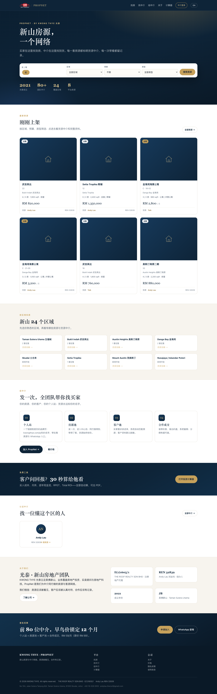

# PropNet 官网（M0）— 说明

> 上线：2026-10-27 · 域名：<https://kwongthye.com/> · 产品名：**PropNet**，署名 by KWONG THYE



---

## 1. 这次做了什么

| 页面 | URL | 内容 |
| :--- | :--- | :--- |
| 首页 | `/` | 搜索（买/租 · 区域 · 预算 · 房型）、精选房源、区域入口、给中介的四件事、计算器、认证中介、关于、招募 CTA |
| 公司介绍 | `/about/` | **原首页内容整体搬到这里**（关于/业务/科技/创办人/联系），标题与 JSON-LD 保留品牌词 |
| 找房 | `/properties/` | 关键词 + 区域 + 房型 + 价格区间筛选、分页、房源详情弹窗（货源中介 + 电话/WhatsApp） |
| 找中介 | `/agents/` | 认证中介目录（REN、在售数量、按中介筛选房源） |
| 给中介 | `/join/` | 价值说明 + 申请表单（进 `agent_leads`，后台可见 + 邮件通知） |
| 价格 | `/pricing/` | 四档：计算器免费 / Pool 免费 / Pro RM89 / 团队 RM299；早鸟 RM59 锁 12 个月 |
| 静态资源 | `/site.css` `/site.js` | 平台官网共用样式与中英切换 |

> 计算器仍在 `calc.kwongthye.com`（免费）；内部资料库仍在 `/library/`（noindex）。

---

## 2. 房源怎么出现在官网

- 资料库里的房源有 `visibility` 字段：`pool`（只在池内，默认）/ `public`（公开到官网）。
- 官网只显示 `visibility='public'` 且状态为 `available` / `reserved` 的房源。
- 公开字段经过裁剪：**不返回业主、备注、完整地址、门牌以外的隐私信息**；只显示「货源中介 + REN」与项目/区域/价格/面积。
- 目前（M0）发布/取消公开需要改数据库；M1 会在 `/app` 里做成一个开关。

```sql
-- 公开一条（M1 前的手工方式）
UPDATE lib_properties SET visibility='public', published_at=now() WHERE code='KT-0001';
-- 收回
UPDATE lib_properties SET visibility='pool', published_at=NULL WHERE code='KT-0001';
```

> 当前生产库的 9 条示例房源已全部 **退回 pool**，官网显示「首批房源正在录入」。这是刻意的：上线第一天不公开假房源。

---

## 3. 申请表单（/join → 后台）

1. 访客填姓名/电话/邮箱/REN/团队/留言 → `POST /api/public/leads`（限流 5 次/10 分钟）
2. 写入 `agent_leads`（记录 IP 哈希，不存明文 IP）
3. 同时发邮件到 `ADMIN_EMAIL`（未配置 SMTP/Resend 时写 `mail.log`）
4. 后台 `/admin/` → **加入申请** 标签：查看、改状态（新申请 / 已联系 / 已加入 / 已放弃）

---

## 4. SEO 与索引

- 每页独立 `title` / `description` / `canonical` / OG。
- 首页 JSON-LD：`RealEstateAgent` + `WebSite`（含 SearchAction）。
- `sitemap.xml`：首页、找房、找中介、给中介、价格、关于、计算器、隐私、条款。
- `robots.txt`：屏蔽 `/admin` `/receipt` `/library` `/app`；其余允许。
- 注意：详情页与筛选结果是**前端渲染**，Google 目前只能索引 `/properties/` 列表页；M1 会给房源详情做服务端直出（`/properties/KT-0001`）再进 sitemap。

**上线后要做的三件事**：
1. Search Console → 提交 `https://kwongthye.com/sitemap.xml`
2. 检查 `site:kwongthye.com` 收录变化（改版后 2 周内每天看一次）
3. 首页主题从「公司介绍」变成「房源平台」，`/about/` 保留品牌词，排名会重新计算

---

## 5. 部署

```bash
bash deploy/deploy.sh     # 跑测试 → 同步 web/ → 传 API → 重启 → 健康检查
```

- 新增后端文件 `work/public-api.js` 已加入 `deploy.sh` 的拷贝列表。
- 数据库迁移：`work/migrations/018_public.sql`（已执行一次）。
- 备份：整库 `pg_dump`，新表/新字段自动覆盖。

---

## 6. 验收对照（M0）

| 验收项 | 状态 | 证据 |
| :--- | :---: | :--- |
| 首屏 5 秒能看出是找房平台 | ✅ | 首屏 H1「新山房源，一个网络」+ 搜索框 |
| 搜索带条件跳转 | ✅ | 选 Sutera Utama + 50–80 万 → `/properties/?intent=sale&area=sutera_utama&min=500000&max=800000` |
| 导航含 找房/找中介/给中介/关于 | ✅ | 各页头部一致；`/about/` 找到公司、地址、REN |
| 手机无横向滚动 | ✅ | 390px 宽，`scrollWidth - innerWidth = 0` |
| 中英切换 | ✅ | 首页/找房/价格/加入/中介全部有 `data-i18n`，切换后卡片与计数同步 |
| sitemap / robots | ✅ | 见上 |
| `/join` 提交后后台可见 | ✅ | 实测提交 → `/api/admin/leads` 返回该条 → 后台「加入申请」显示 |
| 公开房源不泄露业主 | ✅ | 公开接口只查 8 个字段组，不含 owner/remarks/address |

> 剩余：M1 才做的「发布开关、个人站、WTB、房源详情服务端直出」。

---

## 7. 已知限制

1. 官网房源区目前为空（示例房源已退回池内），M1 中介入驻后自动有内容。
2. 详情用弹窗 + `?p=` 查询参数，没有独立 URL / SEO 页面（M1 补）。
3. 没有图片上传，卡片使用统一的房屋图标占位（M1 接 OSS）。
4. 英文通过 JS 切换，Google 主要索引中文（第二阶段做 `/en/` 静态页）。
