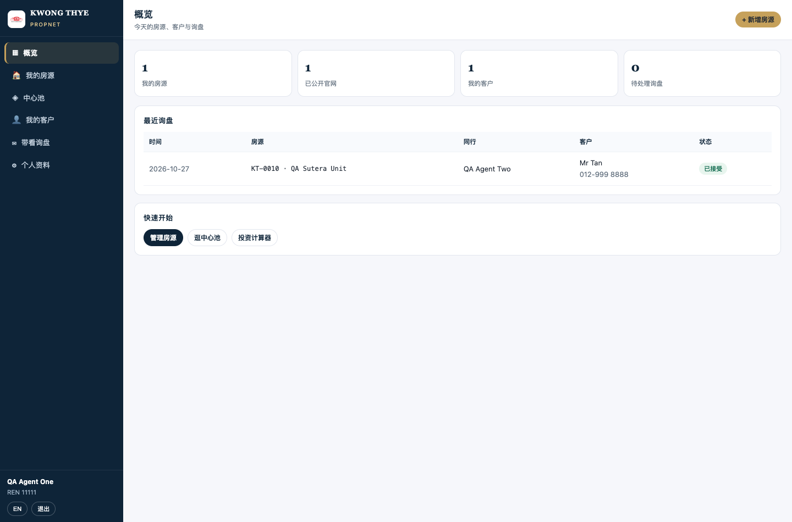
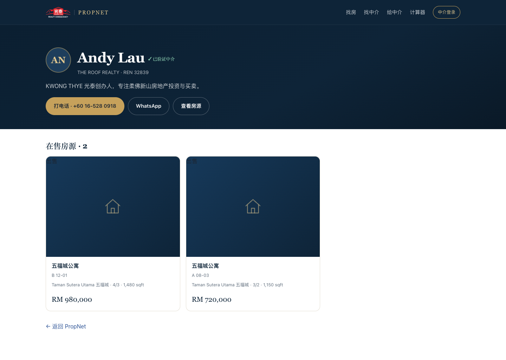
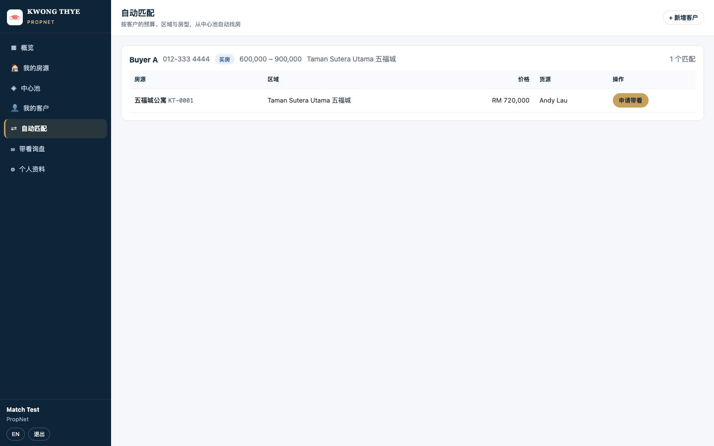
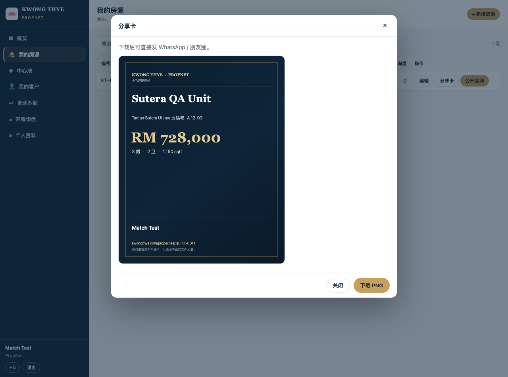

# PropNet 中介工作台（M1）— 说明

> 入口：<https://kwongthye.com/agent/>（内部路径 `/agent/`；`/app` 已被 PropReel 视频平台占用）  
> 上线：2026-10-27 · 状态：自助注册/发房源/公开官网/中心池/客户/匹配/个人站/分享卡均已上线





---

## 1. 账号体系

| 项 | 做法 |
| :--- | :--- |
| 注册 | 姓名 + 邮箱 + 密码（≥8 位）+ 电话/团队/REN；立即生效，无需等审核 |
| 登录 | 邮箱 + 密码；scrypt 加盐哈希；连续失败由限流拦截 |
| 会话 | `pn_sid` cookie：HttpOnly + Secure + SameSite=Lax，30 天 |
| 邮箱验证 | 注册即发验证链接（48 小时）；验证后房源显示「已验证」；可重发 |
| REN | 自助填写；目前不做强制审核，M2 接人工审核队列 |
| 隔离 | 每条房源/客户带 `tenant_id` = 中介 id；只能读写自己的记录 |

> 与资料库（`/library`）不同：`/library` 是公司内部后台（admin），`/agent` 是中介自助工作台。

---

## 2. 工作台能做什么

| 页面 | 功能 |
| :--- | :--- |
| 概览 | 房源/公开/客户/待处理询盘四个数字 + 最近询盘 + 快捷入口 |
| 我的房源 | 列表、搜索、新增、编辑、删除；**一键公开到官网 / 收回池内**；显示询盘数 |
| 中心池 | 全马同行房源（`pool` + `public`）；按州/区域/房型筛选；看货源中介与电话；**申请带看** |
| 我的客户 | 买家/租客需求：预算、意向、区域、状态；只有自己可见 |
| 带看询盘 | 收到的 / 我发出的；接受、拒绝、标记完成 |
| 个人资料 | 姓名、电话、团队、REN、简介、个人页 slug、专长区域（州→区域选择器） |

---

## 3. 发布规则

```
新建房源 → visibility='pool'（仅中介可见，进中心池）
勾选「公开官网」→ visibility='public' + published_at=now()
收回 → visibility='pool' + published_at=null
```

- 官网只显示 `public` 且状态 `available` / `reserved`。
- 公开前必须有价格（售价或租金），否则返回 `need_price`。
- 公开出去的信息不含业主、备注、完整地址。
- 公开/收回都写 `lib_audit`，可追溯。

---

## 4. 带看归因

1. 中介 B 在中心池看到中介 A 的房源，点「申请带看」
2. 填客户姓名/电话/留言 → `pool_inquiries`（from=B, to=A）
3. A 收到站内询盘 + 邮件通知（SMTP/Resend 未配置时写 `mail.log`）
4. A 接受/拒绝；完成后标记 `done`
5. 这条记录就是「谁带来的客」的凭据（M2 接成交与分佣记录）

---

## 5. API（`/api/agent`）

| 方法 | 路径 | 说明 |
| :--- | :--- | :--- |
| POST | `/register` | 注册（自动登录） |
| POST | `/login` · `/logout` | 登录 / 退出 |
| GET | `/me` | 当前中介 + 四个统计 |
| PATCH | `/me` | 改资料 / slug / 区域 |
| POST | `/verify-email` · `/resend-verify` | 邮箱验证 |
| GET/POST | `/listings` | 我的房源列表 / 新建 |
| GET/PATCH/DELETE | `/listings/:id` | 详情 / 编辑 / 删除（仅本人） |
| POST | `/listings/:id/publish` | `{public:true|false}` 公开/收回 |
| GET/POST | `/clients` | 我的客户 |
| PATCH/DELETE | `/clients/:id` | 编辑 / 删除 |
| GET | `/pool` | 中心池（q/state/area/type/intent） |
| POST | `/inquiries` | 申请带看 |
| GET | `/inquiries?box=in|out` | 收到 / 发出 |
| PATCH | `/inquiries/:id` | accepted / declined / done |

所有写操作走 `origin` 校验（CSRF），注册/登录/询盘有限流。

---

## 6. 数据表（迁移 020 / 021）

- `agent_sessions`：会话（token 只存 sha256）
- `agent_tokens`：邮箱验证 token（48 小时，一次性）
- `pool_inquiries`：带看询盘（from/to/客户/状态）
- `lib_agents`：加 `password_hash`、`email_verified_at`、`status`、`last_login_at`
- `lib_clients`：加 `tenant_id`（客户隔离）

---

## 7. 已验收（2026-10-27）

| 项 | 结果 |
| :--- | :--- |
| 注册 → 自动登录 | ✅ 新账号拿到 slug，`/me` 返回统计 |
| 新建房源 | ✅ `KT-0010`，默认 `pool`，区域自动带出 `johor` |
| 公开官网 | ✅ `public` + `published_at`，公开 API 立即可见 |
| 收回 | ✅ 回到 `pool`，公开 API 消失 |
| 中心池 | ✅ 另一个账号能看到，显示货源中介与 REN |
| 申请带看 | ✅ 写入询盘，房源主收到；接受后状态 `accepted` |
| 客户 CRUD | ✅ 创建/列表/编辑 |
| 邮箱验证 | ✅ token 验证后 `emailVerified=true` |
| 手机 | ✅ 390px 无横向滚动 |
| 单元测试 | ✅ `node work/test-agent.js` 9 项 |
| 控制台 | ✅ 无 JS 报错 |

---

## 7.5 M2 已上线的三件事

### 个人站 `/a/:slug`

- 服务端渲染（Express 直出），搜索引擎可收录
- 内容：中介头像/姓名/团队/REN/验证标记/简介/专长区域、其公开房源、电话/WhatsApp/查看房源
- SEO：独立 title/description/canonical/OG + JSON-LD `RealEstateAgent`
- 中英：`?lang=en`
- 缓存 5 分钟；`public=true` 才可访问

### WTB 自动匹配

- 工作台「自动匹配」：按客户的买/租、预算、区域、房型、房间数，从中心池（pool + public）打分
- 每条客户最多 6 个匹配；可直接「申请带看」
- 排除自己的房源；预算上下浮动 5% / 10%



### 分享卡 PNG

- 房源列表 →「分享卡」→ 浏览器 canvas 生成 1080×1350 PNG
- 含品牌、楼盘、区域/单位、价格、房型、中介姓名/REN、房源链接
- 一键下载，可直接发 WhatsApp



## 8. 已知限制 / 待办

1. 每日摘要（新匹配/新询盘邮件）还没上 — M2 剩余
2. 没有图片上传（房源卡片沿用统一占位图）
3. REN 未做人工审核，只有「已填」
4. 询盘/摘要邮件依赖 SMTP/Resend 配置
5. 马来语未上（先中英）
6. 个人站暂无分页（最多 60 条公开房源）
