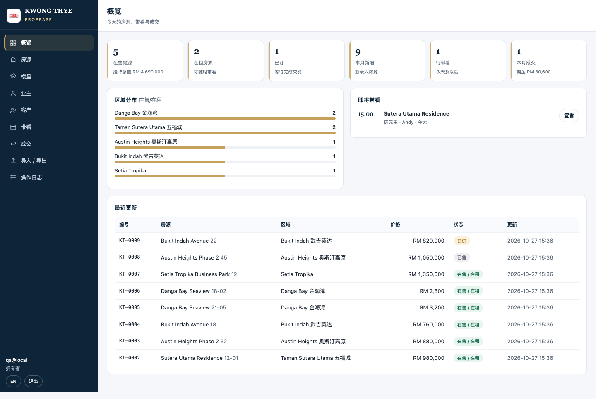
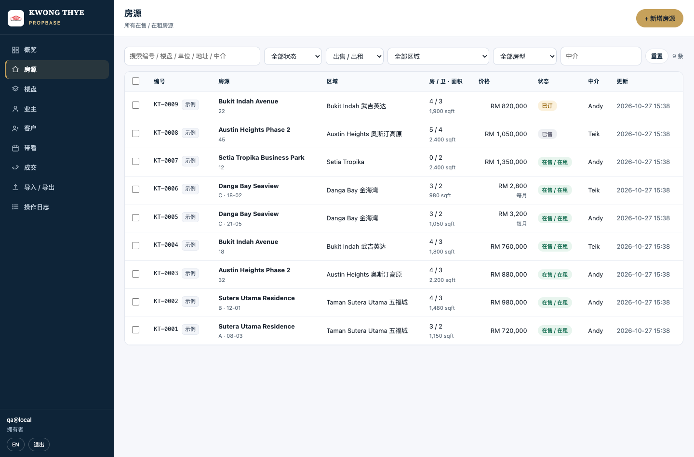
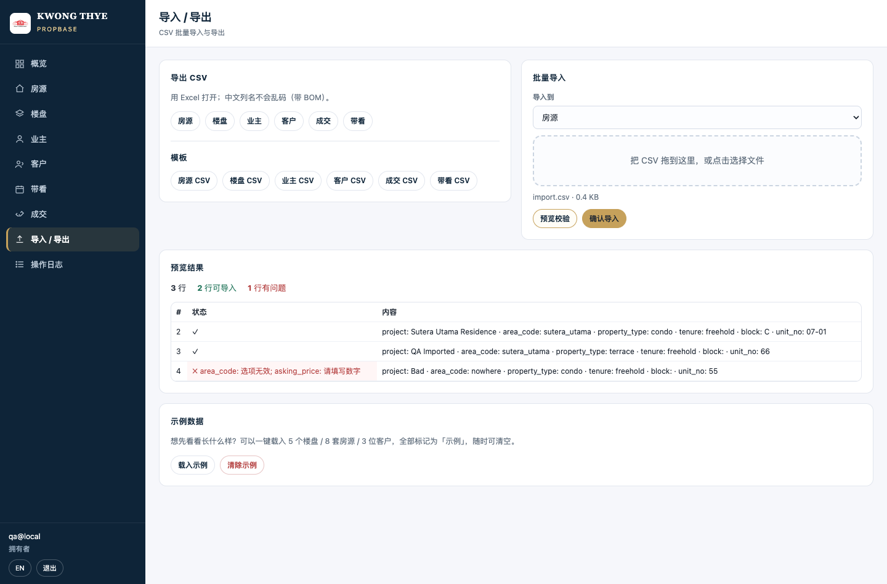
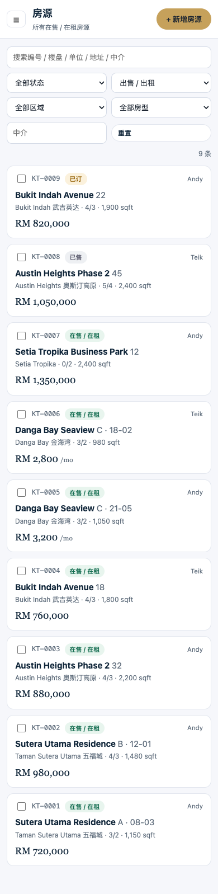

# 房产资料库 PropBase — 说明（v1.0 · 2026-10-27）

> 入口：<https://kwongthye.com/library/>  
> 定位：公司自己的**房产资料库 + 管理系统**——楼盘、房源、业主、客户、带看、成交、改价、审计，全部在一个地方。  
> 与投资计算器、PropMatch 配对并列，同一套后端（PostgreSQL）与后台账号。



---

## 1. 一句话

中介每天要回答的问题——「这个楼盘还有哪些单位？」「这个业主名下几套？」「这个客户看过哪几间？」「这个月成交多少、佣金多少？」——以前散在 Excel、WhatsApp、脑子里；现在一个表一个搜索框。

---

## 2. 谁能用 · 怎么进

| 项 | 说明 |
| :--- | :--- |
| 账号 | **沿用管理后台账号**（`admins` 表）。不需要另建账号。 |
| 登录 | 邮箱 + 密码 → 邮件 6 位验证码 → 进入；勾「记住这台设备 7 天」可一周免验证码 |
| 角色 | `owner` / `admin` 可增删改；`viewer` **只读**（看得到、改不了，顶部按钮自动隐藏） |
| 会话 | Cookie `fc_admin`，与 `/admin/` 共用；默认 2 小时，勾记住 = 7 天 |
| 互跳 | 后台 `/admin/` 页头有「资料库 Library」入口 |

> 客户账号（`users`）**不能**进资料库；反之管理员账号也不影响客户侧功能。

---

## 3. 功能地图

| 页面 | 做什么 |
| :--- | :--- |
| **概览** | 在售 / 在租 / 已订 / 本月新增 / 待带看 / 本月成交 + 挂牌总值、佣金；区域分布条形图；最近更新 8 条；即将带看 |
| **房源** | 搜索（编号/楼盘/单位/地址/中介/备注）、状态/意向/区域/房型/中介筛选、排序、分页、**批量改状态 / 改中介 / 删除**；点行进详情 |
| **房源详情** | 价格（含每平方尺）、状态、全部字段、业主卡片（拨号 / WhatsApp）、卖点标签、备注、**改价历史**、带看、成交、创建/更新记录；「算回报」直接带着房价跳到计算器；「复制资料」生成 WhatsApp 文本 |
| **楼盘** | 楼盘字典：区域、房型、产权、总单位数、落成年份、开发商、设施；自动统计名下单位数、在售数、均价 |
| **业主** | 业主/房东名册：电话、备用电话、邮箱、身份证后 4 位、来源、备注；显示名下房源数 |
| **客户** | 买家/租客：意向、预算区间、想看区域（多选）、房型（多选）、最少房间、时间表、状态（新客→跟进→看房→谈价→成交/流失）、中介 |
| **带看** | 日期/时间、房源、客户、中介、状态（已约/已看/未到/取消）、反馈；支持「今天 / 即将」筛选 |
| **成交** | 成交价、日期、佣金率、**佣金自动算**（可手改）、类型（买卖/租赁）、状态；保存为「已完成」会自动把房源改成已售/已租 |
| **导入 / 导出** | 6 类实体 CSV 导出（带 BOM，Excel 不乱码）、模板下载、拖拽导入（**先预览校验再写入**，逐行报错） |
| **操作日志** | 谁、什么时候、对哪条记录做了什么（create/update/delete/import/bulk/export/demo） |

**中英双语**：右上角一键切换，偏好存本地；所有页面、表单、弹窗、空状态、错误提示都有中英两套。

**手机**：≤820px 自动切换卡片列表 + 抽屉式侧栏；顶部汉堡菜单。







---

## 4. 数据模型（9 张表，全部在 `fangchan` 库）

| 表 | 作用 | 关键点 |
| :--- | :--- | :--- |
| `lib_projects` | 楼盘字典 | `(lower(name), coalesce(area_code,''))` 唯一，防重复建盘 |
| `lib_properties` | 房源 | 编号 `KT-0001` 自动生成；同一楼盘+座+单位号**唯一**；`is_demo` 标记示例数据 |
| `lib_owners` | 业主 | 电话索引；删除时若有房源会拒绝（除非 force） |
| `lib_clients` | 客户 | `area_codes` / `property_types` 用数组；预算区间校验下限 ≤ 上限 |
| `lib_viewings` | 带看 | 删除房源时级联删除 |
| `lib_deals` | 成交 | 未填佣金金额时按「成交价 × 佣金率」自动算 |
| `lib_price_events` | 改价历史 | 每次改 `asking_price` / `rent_price` 自动记一条（谁改的） |
| `lib_audit` | 审计 | 所有写操作留痕，detail 为 JSONB |
| `lib_agents` | 中介名册 | 只用于下拉选择，不用于登录 |

金额一律 `NUMERIC(18,2)`，日期一律 `DATE`（出参转 `YYYY-MM-DD` 文本）。

---

## 5. 关键规则

1. **编号**：`KT-` + 4 位序号，由 `lib_property_code_seq` 生成，不回收。
2. **去重**：同一 `project_id + block + unit_no` 只能有一条；重复录入返回 `409 duplicate_unit` 并给出已存在那条的 id。
3. **区域/房型/产权继承**：选了楼盘，区域、房型、产权、地址自动带出（可手改）。
4. **状态流转**：`available → reserved → sold / rented`，或 `off_market`；成交保存后自动推进状态。
5. **佣金**：`commission_amount` 留空 = `price × rate%`；填了就不覆盖。
6. **删除**：房源删除会带走改价/带看历史；成交记录保留（`property_id` 置空）。
7. **导入**：最多 2000 行；先预览（不写库），确认后才写入；`project` 名称匹配已有楼盘，匹配不到就存为自由文本 `project_name`；`owner_name` 匹配已有业主，匹配不到则**自动建业主**。
8. **审计**：写操作都会写 `lib_audit`，含操作人邮箱。

---

## 6. API（挂在 `/api/library`，全部要管理员会话）

| 方法 | 路径 | 说明 |
| :--- | :--- | :--- |
| GET | `/meta` | 字典（区域/房型/状态…）+ 当前角色 |
| GET | `/overview` | 概览统计 |
| GET | `/properties` | 列表：`q,status,intent,area,type,agent,project_id,beds,minPrice,maxPrice,sort,dir,page,pageSize` |
| POST | `/properties` | 新建 |
| GET/PATCH/DELETE | `/properties/:id` | 详情（含改价/带看/成交/业主）/ 修改 / 删除 |
| POST | `/properties/bulk` | 批量：`{ids,action:status|agent|delete,value}` |
| GET/POST | `/projects`、`/owners`、`/clients`、`/viewings`、`/deals` | 列表 / 新建 |
| GET/PATCH/DELETE | 同上 `/:id` | 单条 |
| GET/POST/PATCH | `/agents` | 中介名册 |
| GET | `/audit` | 操作日志 |
| GET | `/export/:entity` | CSV（`properties/projects/owners/clients/deals/viewings`），`?lang=zh|en` 追加可读标签列 |
| GET | `/export/:entity/template` | CSV 模板 |
| POST | `/import` | `{entity,mode:preview|commit,csv}` |
| POST/DELETE | `/demo` | 载入 / 清除示例数据 |

错误统一 `{ok:false,error,fields?}`；`401 auth_required`、`403 read_only`、`409 duplicate_unit|duplicate_project|project_in_use`。

---

## 7. 部署 / 运维

```bash
# 第一次或表结构变更
scp work/migrations/017_library.sql root@47.254.235.22:/tmp/
ssh root@47.254.235.22 "chmod 644 /tmp/017_library.sql && sudo -u postgres psql -d fangchan -f /tmp/017_library.sql"

# 日常发布（会跑两套测试 + 同步静态 + 重启 API + 健康检查）
bash deploy/deploy.sh
```

- `deploy/deploy.sh` 已包含 `work/test-library.js`（62 项）与 `library-*.js` 三个后端文件。
- 备份：`pg_dump` 是整个库，新表**自动纳入**本地 + 吉隆坡 + 新加坡三份备份，无需改脚本。
- 监控：`monitor.js` 检查 `/api/health`，资料库异常会体现在心跳邮件。

---

## 8. 验收记录（2026-10-27）

| 项 | 结果 |
| :--- | :--- |
| 单元测试 | `node work/test-library.js` → **62 pass, 0 fail**（金额/日期解析、枚举、预算区间、佣金、CSV、分页排序、注入防护） |
| 原有测试 | `node web/test.js` → 69 pass，未被影响 |
| 接口实测 | 建盘/建房/重复拦截/改价（自动记 history）/批量改状态/审计/导出（BOM）/导入（预览 3 行 2 有效 1 报错 → 提交 2 条）全部通过 |
| 权限 | `viewer` GET 200、POST 403 `read_only` |
| 浏览器 | 概览、房源、详情、表单、楼盘、导入、日志、英文、手机端 0 console error；手机无横向溢出 |
| 计算器联动 | 房源「算回报」→ 计算器预填 SPA 720,000 / 贷款 648,000 / 利率 4.3 / 持有 5 年 |
| 数据 | 生产库当前为**示例数据**（5 楼盘 / 9 房源 / 3 业主 / 3 客户 / 2 带看 / 1 成交），全部标 `is_demo`，可在「导入 / 导出」页一键清除 |

---

## 9. 下一步（按优先级）

1. **房源图片 / 文件**：目前只有字段，没有照片、平面图、地契附件（建议直接传 OSS，存 URL + sha256）。
2. **公开房源页 / 分享卡片**：给客户看的只读页面 + WhatsApp 预览图（现在只有复制文本）。
3. **与 PropMatch 互通**：资料库房源直接进配对池，客户需求双向同步（避免两套数据）。
4. **团队账号**：现在是后台账号共用；以后要「每个中介一个账号 + 只看自己的盘」。
5. **报表**：月度成交/佣金汇总、房源去化周期、各区域均价趋势（现在只有概览数字）。
6. **Excel 导出**（带格式）与定时邮件周报。
